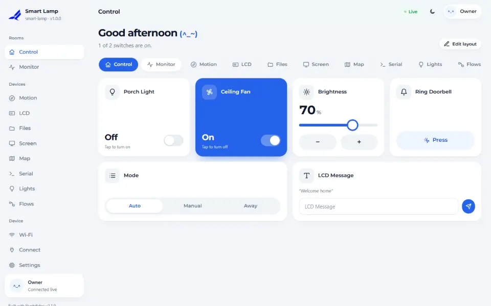
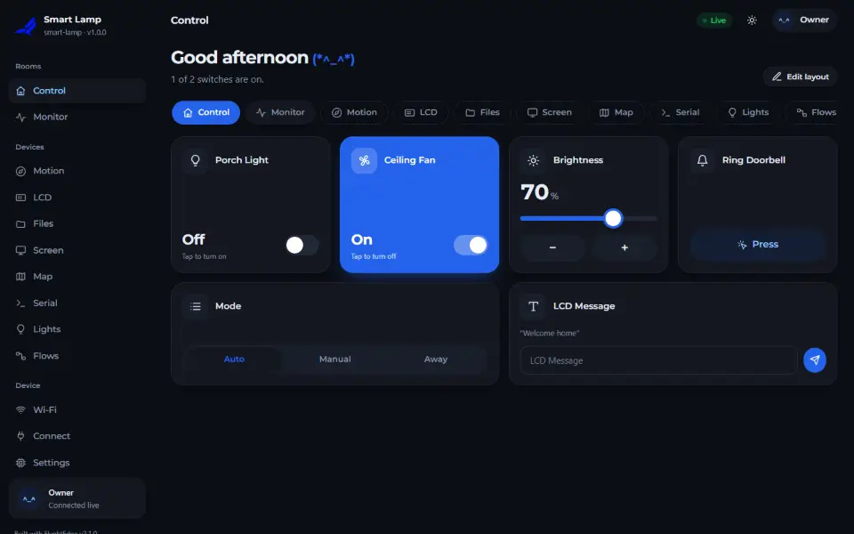
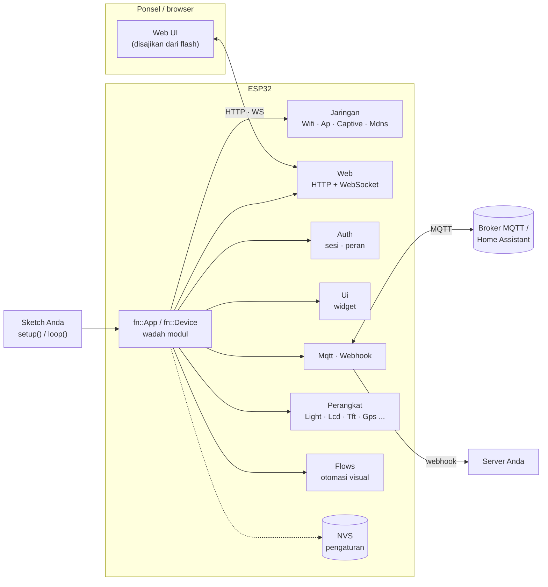
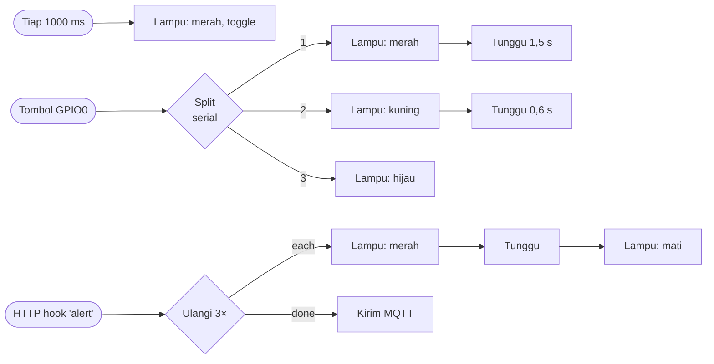

<div align="center">

# FlyghtEdge

**Dashboard web di ponsel untuk semua ESP32, cukup 5 baris kode.**

Portal setup Wi-Fi · captive portal yang terbuka sendiri · mDNS · login & sesi · dashboard drag-and-drop ·
lampu & efek · alur visual (flows) · MQTT + Home Assistant · HTTP REST API · webhook · OTA

`ESP32` · `ESP32-S2` · `ESP32-S3` · `ESP32-C3` · `ESP32-C5` · `ESP32-C6` — Arduino-ESP32 core 3.x

[English](README.md) · **Bahasa Indonesia**

<!-- flyght-cloud-header:start -->
> **Dashboard Flyght Cloud:** [flyght.obayan.id](https://flyght.obayan.id) adalah dashboard web resmi untuk perangkat ini: satu tempat untuk semua board Anda, dari mana saja. Opsional dan mati secara bawaan.
<!-- flyght-cloud-header:end -->

</div>

---

## Daftar isi

1. [Mulai cepat](#mulai-cepat)
2. [Fitur](#fitur)
3. [Gambaran arsitektur](#gambaran-arsitektur)
4. [Instalasi](#instalasi)
5. [Contoh program](#contoh-program)
6. [Widget dashboard](#widget-dashboard)
7. [Lampu (LED)](#lampu-led)
8. [Alur visual (Flows)](#alur-visual-flows)
9. [Perangkat tambahan](#perangkat-tambahan)
10. [Relay, sensor, dan motor](#relay-sensor-dan-motor)
11. [API key lisensi dan edisi](#api-key-lisensi-dan-edisi)
12. [Integrasi: MQTT, HTTP, webhook](#integrasi)
13. [Flyght Cloud](#flyght-cloud)
14. [Pemakaian modular](#pemakaian-modular)
15. [Peta dokumentasi](#peta-dokumentasi)
16. [Kendala umum](#kendala-umum)
17. [Lisensi](#lisensi)

---

## Mulai cepat

```cpp
#include <FlyghtEdge.h>

fn::Device dev("smart-lamp");

void setup() {
  pinMode(2, OUTPUT);
  dev.page("Kontrol").toggle("lampu", "Lampu Teras", [](bool on) { digitalWrite(2, on); });
  dev.license("fnk_live_...");  // API key kamu; tanpa key: evaluasi 30 menit
  dev.begin();
}

void loop() { dev.loop(); }
```

| Langkah | Yang Anda lakukan | Yang terjadi |
|:-:|---|---|
| 1 | Upload (Partition Scheme **"No FS 4MB (2MB APP x2)"**) | Board memancarkan Wi-Fi sendiri `smart-lamp-XXXX` |
| 2 | Sambungkan ponsel ke Wi-Fi itu | Dashboard **terbuka otomatis** (captive portal) |
| 3 | Pilih **Saya punya key** atau **Setup online** | Keduanya diawali password admin |
| 4 | Buat password admin | Langsung masuk; sesi tersimpan 30 hari |
| 5 | *Saya punya key:* tempel key, lalu pilih Wi-Fi rumah. *Setup online:* pilih Wi-Fi rumah, lalu buka tautan untuk membuat key di situs Flyght dan tempel di sini | Flyght Cloud tersambung setelah Wi-Fi aktif (lewati key untuk tetap lokal) |
| 6 | Buka `http://smart-lamp-xxxx.local` dari perangkat mana pun di jaringan itu | Dashboard |

Key yang diketik di wizard menyambungkan perangkat ke Flyght Cloud. Edisi firmware tetap berasal dari
`dev.license()` di sketch. Wizard menyimpan satu Wi-Fi; cadangan ditambah nanti di halaman Network
(sampai 8, dicoba menurut prioritas).

Tersambung ulang atau board restart? Tidak perlu login lagi.

## Tampilan

<p align="center">
  
  
</p>

<p align="center"><sub>Screenshot berasal dari simulator yang ikut proyek; ia menyajikan dashboard yang sama dengan firmware. [Semua layar, desktop dan ponsel](docs/guides/15-screen-catalog.md).</sub></p>

## Panduan

Panduan langkah demi langkah dengan diagram pengawatan, kode yang bisa di-compile, dan screenshot ada di
[docs/guides](docs/guides/README.md) (berbahasa Inggris):
[mulai](docs/guides/01-getting-started.md) ·
[dashboard](docs/guides/02-dashboard-and-pages.md) ·
[Wi-Fi](docs/guides/03-wifi-and-provisioning.md) ·
[GPS](docs/guides/04-gps.md) ·
[TFT](docs/guides/05-tft.md) ·
[kartu SD](docs/guides/06-sd-card.md) ·
[LCD dan IMU](docs/guides/07-lcd-and-imu.md) ·
[MCU link](docs/guides/08-mcu-link.md) ·
[MQTT dan Home Assistant](docs/guides/09-mqtt-and-home-assistant.md) ·
[webhook dan flows](docs/guides/10-webhooks-and-flows.md) ·
[relay, sensor, dan motor](docs/guides/11-relays-sensors-motors.md) ·
[Flyght Cloud](docs/guides/12-flyght-cloud.md) ·
[pengawatan dan pinout](docs/guides/13-wiring-and-pinout.md) ·
[pemecahan masalah](docs/guides/14-troubleshooting.md) ·
[katalog layar](docs/guides/15-screen-catalog.md)

## Fitur

| Bidang | Isi |
|---|---|
| **Setup & jaringan** | Access point untuk setup, captive portal (Android, iOS/macOS, Windows, Firefox + DHCP option 114), simpan sampai 8 Wi-Fi dengan prioritas dan pindah otomatis, mDNS `nama.local` |
| **Login** | Password admin (PBKDF2), sesi bertanda tangan HMAC yang bertahan setelah restart, pembatasan percobaan login, akses tamu (opsional), akun & peran (opsional) |
| **Dashboard** | Toggle, tombol, slider, gauge, nilai, grafik, pilihan, teks — dideklarasikan di C++. Banyak halaman, update langsung lewat WebSocket, tata letak drag-and-drop disimpan di perangkat, tema terang/gelap, Inggris + Indonesia |
| **Lampu** | LED biasa (digital/PWM) dan LED RGB (piksel bawaan atau 3 pin), color picker, kecerahan, 12 efek non-blocking |
| **Alur visual** | Editor node di browser: pemicu → logika → aksi, cabang serial atau paralel, opsional thread FreeRTOS per alur |
| **Perangkat** | IMU BNO055, LCD I2C, kartu SD, layar TFT, GPS dengan peta, MCU eksternal lewat UART — masing-masing punya halaman |
| **Integrasi** | MQTT (topik state/set, retained, LWT, discovery Home Assistant), HTTP REST dengan token, webhook bertanda tangan |
| **Sistem** | Kesehatan modul, log langsung, update OTA, restart, reset pabrik, jam dari NTP atau browser |

## Gambaran arsitektur



Setiap fitur adalah sebuah `fn::Module`: punya dependensi, dijalankan berurutan sesuai dependensi,
berjalan di `dev.loop()`, melaporkan kesehatan, dan menyimpan pengaturannya di NVS. Diagram lain:
[docs/ARCHITECTURE.md](docs/ARCHITECTURE.md) (bahasa Inggris).

## Instalasi

| Alat | Caranya |
|---|---|
| Arduino IDE | *Sketch → Include Library → Add .ZIP Library…* lalu pilih `FlyghtEdge-<versi>.zip` (atau Library Manager bila sudah terdaftar) |
| arduino-cli | `arduino-cli lib install --zip-path FlyghtEdge-<versi>.zip` |
| PlatformIO | `lib_deps = flyght-ninno/FlyghtEdge` (framework Arduino, espressif32 dengan core Arduino 3.x) |

Kebutuhan: **Arduino-ESP32 core 3.3.x**. Paket rilis berisi header publik dan arsip precompiled
untuk tiap chip (`src/<chip>/libFlyghtEdge.a`).

**Partition scheme (penting).** Build lengkap berukuran 1,3–1,7 MB, lebih besar dari partisi
aplikasi bawaan 1,2 MB. Setiap contoh membawa `partitions.csv` (dua slot OTA 1,9 MB, tanpa SPIFFS),
dan batas upload juga perlu dinaikkan:

| Alat | Pengaturan |
|---|---|
| Arduino IDE | Tools → Partition Scheme → **No FS 4MB (2MB APP x2)** |
| arduino-cli | `--fqbn esp32:esp32:esp32s3:PartitionScheme=no_fs` |
| PlatformIO | `board_build.partitions = partitions.csv` |

## Contoh program

| Contoh | Isi | Perangkat keras |
|---|---|---|
| `01_SmartLamp` | Aplikasi terkecil: satu toggle | ESP32 + LED |
| `02_SensorMqtt` | Gauge, grafik, slider, pilihan, MQTT + HTTP | ESP32 apa saja |
| `03_CustomModule` | Membuat `fn::Module` sendiri | ESP32 apa saja |
| `04_ModularApp` | `fn::App` hanya dengan modul yang dipilih | ESP32 apa saja |
| `05_Devices` | IMU, LCD, SD, TFT, GPS, MCU dengan pin per chip | perangkat yang Anda punya |
| `06_BuiltinLed` | Lampu, color picker, efek, alur visual, tombol BOOT | **cukup board-nya** |
| `07_Relays` | Board relay multi-kanal (active-high / low, latching), interlock, waktu nyala maksimum, pin bisa dipindah dari menu kartu | board relay |
| `08_Sensors` | DHT, DS18B20, level tangki ultrasonik, analog, saklar kebocoran, CO2 | sensor yang Anda punya |
| `09_Motors` | Motor DC, ESC brushless, stepper, katup solenoid | driver yang Anda punya |
| `10_GpsTracker` | Peta GPS, jejak, kecepatan, satelit | modul GPS |
| `11_GpsGeofence` | Sirene saat perangkat keluar dari lingkaran | GPS + relay |
| `12_TftStatus` | Nilai di layar warna, dicerminkan langsung | ST7789 / ILI9341 |
| `13_SdLogger` | Logger CSV dan file manager | modul kartu SD |
| `14_LcdStatus` | Layar 16x2 dengan sakelar lampu latar | LCD I2C |
| `15_ImuTilt` | Pitch, roll, dan alarm miring | BNO055 |
| `16_McuBridge` | Nilai dari dan perintah ke board lain | MCU apa pun lewat UART |
| `17_DashboardTour` | Semua tipe widget, halaman, ukuran, role | **cukup board-nya** |
| `18_HomeAssistant` | MQTT dengan discovery Home Assistant | broker |
| `19_WebhookAlerts` | Webhook bertanda tangan dari sakelar pintu | sakelar |
| `20_FlowsRules` | Aturan yang digambar di browser | relay + tombol |
| `21_CloudClaim` | Mendaftarkan perangkat ke Flyght Cloud | Wi-Fi + key |
| `22_Greenhouse` | DHT22, kipas, dan pompa dengan alarm | DHT22 + relay |
| `23_TankPump` | Kontrol level air dengan proteksi pompa kering | ultrasonik + float switch + relay |
| `24_PowerMonitor` | V/A/W/kWh listrik dengan pemutus arus lebih | PZEM-004T + relay |

## Widget dashboard

```cpp
dev.page("Monitor", "activity")
   .gauge("suhu", "Suhu", "°C", 0, 50)
   .chart("riwayat", "Riwayat", "°C", 90).every(2000).size(2)
   .value("daya", "Daya", "W").decimals(0).icon("zap");

dev.page("Kontrol", "sliders")
   .toggle("pompa", "Pompa", [](bool on) { digitalWrite(POMPA, on); })
   .slider("kipas", "Kipas", 0, 100, 5, [](float v) { analogWrite(KIPAS, v * 2.55); }).unit("%")
   .select("mode", "Mode", {"Auto", "Manual", "Pergi"}, [](const String& m) { /* ... */ })
   .button("bel", "Bunyikan", [] { /* ... */ })
   .text("pesan", "Pesan LCD", [](const String& s) { /* ... */ }).role(fn::Role::Admin);

dev.ui().set("suhu", 24.5);   // dari loop(): dikirim langsung ke browser, MQTT dan webhook
```

| Widget | Nilai | Callback |
|---|---|---|
| `toggle(id, label, cb)` | nyala/mati | `void(bool)` |
| `button(id, label, cb)` | — | `void()` |
| `slider(id, label, min, max, step, cb)` | angka | `void(float)` |
| `select(id, label, {pilihan}, cb)` | teks | `void(const String&)` |
| `text(id, label, cb)` | teks | `void(const String&)` |
| `gauge(id, label, satuan, min, max)` | angka (hanya baca) | — |
| `value(id, label, satuan)` | angka atau teks (hanya baca) | — |
| `chart(id, label, satuan, titik)` | deret angka (hanya baca) | — |

Pengubah berlaku untuk widget terakhir: `size(1..3)`, `icon(nama)`, `unit()`, `decimals()`,
`role(peranMinimal)`, `every(ms)`. Daftar lengkap: [docs/REFERENCE.md](docs/REFERENCE.md#page--widgets).

## Lampu (LED)

```cpp
fn::RgbLed piksel(RGB_BUILTIN);       // WS2812 bawaan (DevKit S3 / C3 / C6)
fn::Led status(2);                    // LED biasa dengan PWM (pwm=false → digitalWrite)
fn::RgbLed strip(5, 6, 7, "meja");    // pin R, G, B (commonAnode=true bila perlu)
dev.use(piksel).use(status);

piksel.color(0x2563eb).brightness(60);
piksel.effect(fn::Fx::Breathe, 3000);
```

| Efek | Warna | Kecepatan bawaan | | Efek | Warna | Kecepatan bawaan |
|---|:-:|--:|---|---|:-:|--:|
| `solid` | 1 | — | | `cycle` (dua warna) | 2 | 2000 ms |
| `blink` | 1 | 1000 ms | | `candle` (lilin) | 1 | 1000 ms |
| `breathe` | 1 | 3000 ms | | `police` | 2 | 800 ms |
| `heartbeat` | 1 | 1200 ms | | `sos` | 1 | 200 ms / titik |
| `strobe` | 1 | 120 ms | | `sunrise` | otomatis | 60 s |
| `rainbow` | otomatis | 6000 ms | | `alarm` | 1 | 400 ms |

Efek dihitung dari `millis()` sehingga tidak pernah memblokir `loop()`, dan pratinjau di halaman
**Lights** sama persis dengan LED aslinya. Setiap lampu juga bisa dikontrol lewat HTTP
(`/fn/api/v1/lights/<id>`), MQTT (`<base>/light/<id>/set`) dan blok alur. Kondisi terakhir diingat.

## Alur visual (Flows)

```cpp
fn::Flows flows;
dev.license(FN_LICENSE_KEY);         // alur visual adalah fitur Pro (key Pro)...
dev.features().defaultOn("flows");   // ...dan defaultnya mati
dev.use(flows);
```

Buka **Devices → Flows**, mulai dari contoh, tarik blok dari palet, sambungkan titik kanan sebuah
blok ke titik kiri blok lain, lalu tekan **Run**.



| Kelompok | Blok |
|---|---|
| **Pemicu** | Tombol Run · Saat start-up · Tiap N ms · Widget berubah · Pesan MQTT · HTTP hook · Tombol GPIO |
| **Logika** | Tunggu · If · Ulangi · Split (paralel / serial) · Set nilai |
| **Aksi** | Log · Set widget · Output GPIO · Kirim MQTT · Request HTTP |
| **Perangkat** | Lampu · Efek lampu · Teks LCD · Teks layar · Kirim ke MCU (dan blok dari modul Anda) |

* **Paralel**: beberapa kabel dari satu titik berjalan bersamaan. **Serial**: blok Split mode
  *serial* menjalankan output 1, lalu 2, lalu 3 (cabang beserta waktu tunggunya selesai dulu).
* **Thread**: alur berjalan di loop utama atau, di edisi Enterprise, di task FreeRTOS sendiri.
* **Aman**: blok tidak bisa memakai pin yang dipakai modul (LED, bus), flash SPI atau USB; timer
  minimal 50 ms; maksimal 8 alur × 40 blok, 16 jalannya alur bersamaan per alur.
* Kolom teks menerima `{value}` `{uptime}` `{time}` `{id}` `{name}` (dan `{base}` di topik MQTT).

## Perangkat tambahan

| Bus | Modul | Halaman | Yang didapat |
|---|---|---|---|
| I2C | `fn::Bno055 imu;` | Motion | Horizon, kompas, kotak 3D, kalibrasi, "jadikan datar" |
| I2C | `fn::LcdI2c lcd(16, 2);` | LCD | Cermin layar, tulis per baris, lampu latar, pemindai I2C |
| SPI / SDMMC | `fn::SdCard sd(cs);` | Files | Jelajah, unggah, unduh, ganti nama, hapus, pratinjau |
| SPI | `fn::Tft tft(panel);` | Screen | Cermin piksel dan alat gambar |
| UART | `fn::Gps gps(rx, tx);` | Map | Peta Leaflet, jejak, kecepatan, satelit, ekspor GPX |
| UART | `fn::McuLink mcu(rx, tx);` | Serial | Konsol, telemetri jadi nilai langsung, tombol cepat |
| GPIO | `fn::Led` / `fn::RgbLed` | Lights | Color picker, kecerahan, efek |

Perangkat hanya ikut ke firmware bila Anda membuat objeknya dan memanggil `dev.use(...)`. Pin:
`imu.pins(sda, scl)`, `sd.pins(sck, miso, mosi)`, `panel.pins(sck, mosi, miso)`; `examples/05_Devices`
berisi pin bawaan untuk tiap chip.

## Relay, sensor, dan motor

Untuk komponen IoT yang umum sudah ada modulnya. Masing-masing menjadi kartu di dashboard, hanya ikut ke
firmware bila Anda membuat objeknya, dan bekerja lewat MQTT, Home Assistant, flows, dan Flyght Cloud
seperti widget lain. Lihat `examples/07_Relays`, `08_Sensors`, `09_Motors`.

| Komponen | Modul | Catatan |
|---|---|---|
| Board relay, 1-16 kanal | `fn::Relay` | active-high, active-low, latching (pin set + reset); kondisi awal, pulse, waktu nyala maksimum, grup interlock |
| Katup solenoid | `fn::Solenoid` | relay yang menutup sendiri dan beristirahat di antara pembukaan |
| DHT11 / DHT22 | `fn::Dht` | suhu + kelembapan, satu pin |
| DS18B20 | `fn::Ds18b20` | satu sensor di pin 1-Wire, pull-up 4,7 k |
| Ultrasonik (HC-SR04, JSN-SR04T) | `fn::Ultrasonic` | jarak, level tangki dalam % (opsional), koreksi suhu udara |
| Level air, O2, H2, gas MQ, ACS712 | `fn::AnalogSensor` | output analog apa pun: skala linear, arus Hall, kurva MQ. Hanya pin ADC1 |
| Float switch, kebocoran air, api | `fn::DigitalSensor` | di-debounce, active-low, label sendiri |
| CO2 | `fn::Mhz19` | MH-Z19 lewat UART |
| Meter listrik AC | `fn::Pzem` | PZEM-004T v3 lewat UART: V, A, W, kWh, Hz, faktor daya |
| Tegangan / arus / daya DC | `fn::Ina219` | I2C |
| Motor DC brushed | `fn::DcMotor` | H-bridge (L298N, TB6612, L9110 ...): kecepatan -100..100 %, pembalikan arah lewat nol, ramp, waktu jalan maksimum |
| Motor brushless | `fn::Esc` | lewat ESC: arming dulu, lalu throttle 0..100 % |
| Stepper | `fn::Stepper` | driver step/dir (A4988, DRV8825, TB6600): pindah ke posisi dengan akselerasi |

```cpp
fn::Relay relays("relay", "Ruang pompa");
fn::Dht dht(4);

void setup() {
  relays.channel(5, "Pompa").maxOn(600);         // mati sendiri setelah 10 menit
  relays.channel(6, "Katup", fn::Relay::Type::ActiveLow);
  dht.every(5000).alarm(35, 32);                 // kartu "alarm": menyala di 35 C, mati di 32 C
  dev.use(relays).use(dht);
  dev.begin();
}
```

**Pindahkan pin tanpa compile ulang.** Di setiap kartu milik modul ini, admin melihat menu tiga titik
dengan **Settings**. Dialognya menampilkan pin perangkat, dinamai menurut fungsinya (output GPIO, analog
ADC1, UART RX, I2C SDA, step ...), dan hanya menawarkan pin yang bisa bekerja: bukan pin flash atau USB,
bukan pin input-only untuk output, pin ADC1 untuk input analog, pin yang dipakai perangkat lain tampil
sebagai terpakai, pin boot diberi peringatan. Perangkat yang menggerakkan beban (relay, motor, stepper)
meminta nama perangkat sebelum menyimpan; pin GPIO berlaku seketika (output dimatikan dulu sebelum pin
pindah), pin UART dan I2C dipakai sejak start berikutnya. Pin tersimpan didahulukan dari pin di sketch.

**Perlu diketahui**
* Pembacaan yang tidak bisa dipercaya tampil "—", tidak pernah angka yang tampak masuk akal. Sensor tanpa
  pembacaan valid selama lima interval menjadi *degraded* di kesehatan modul.
* Kalibrasi tanggung jawab Anda. Sensor gas menampilkan apa kata kurvanya; cocokkan dengan acuan.
* Pengawatan: echo HC-SR04 bertegangan 5 V (pakai pembagi), board relay butuh catu sendiri dan dioda
  flyback di tiap kumparan, pin analog 0-3,1 V, pin ADC2 tidak ditawarkan karena mati saat Wi-Fi aktif.
* Pembacaan DHT memakan sekitar 5 ms dengan interupsi mati, sekali tiap interval. Stepper berjalan sampai
  beberapa ribu langkah per detik. Keduanya tidak memblokir dashboard.
* **Bukan fungsi keselamatan.** Interlock, waktu nyala maksimum, dan kartu Stop hanyalah kemudahan;
  emergency stop harus ada di perangkat keras.

---

## API key lisensi dan edisi

Setiap build memerlukan **API key lisensi**: `fnk_live_` diikuti sekitar 150-180 karakter. Key
memuat nama pemilik dan edisi yang dibuka. Key ditandatangani flyght-ninno dengan **ECDSA P-256**
dan diperiksa **offline** di board saat boot, jadi tidak bisa diubah atau dipalsukan, dan tidak
perlu internet. Key Free gratis; key Pro dan Enterprise datang bersama lisensi komersial dan
berlaku untuk rilis yang terbit sampai tanggal update-nya.

```cpp
// secrets.h, di samping sketch dan tidak ikut version control:
#define FN_LICENSE_KEY "fnk_live_..."

dev.license(FN_LICENSE_KEY);             // sebelum dev.begin()
```

| Kondisi | Yang terjadi |
|---|---|
| Key valid | Edisinya dipakai; *Settings → Plan & features* menampilkan "Lisensi atas nama …" |
| Tanpa key, key salah ketik, dicabut atau palsu, atau rilis lebih baru dari tanggal update key | **Mode evaluasi**: semua fitur aktif, ada banner di dashboard, dan setelah **30 menit** aplikasi berhenti (HTTP 402) sampai reset berikutnya |

Log boot menyebutkan kondisi mana yang berlaku dan alasannya. Contoh-contoh membaca key dari
`secrets.h` bila file itu ada. Pada produk, aktifkan Flash Encryption agar key tidak bisa dibaca
dari dump flash.

### Saklar fitur


| Fitur | id | Edisi | Default |
|---|---|---|:-:|
| Akses tamu (tanpa password) | `guest` | Free | mati |
| Token API untuk sistem lain | `apiTokens` | Free | **nyala** |
| Alur visual | `flows` | Pro | mati |
| Akun & peran (viewer / operator / admin) | `rbac` | Pro | mati |
| White label (sembunyikan merek) | `whitelabel` | Pro | mati |
| Alur di thread RTOS | `flowsRtos` | Enterprise | mati |

```cpp
dev.features().defaultOn("rbac");        // default boot pertama; selanjutnya: Settings → Plan & features
if (dev.features().on("rbac")) { ... }   // diizinkan edisi DAN dinyalakan
```

## Integrasi

**MQTT** — topik dasar bawaan `flyght/{id}`.

| Topik | Arah | Isi |
|---|---|---|
| `<base>/status` | perangkat → | `online` / `offline` (retained, LWT) |
| `<base>/state/<widget>` | perangkat → | `ON`/`OFF`, angka atau teks |
| `<base>/set/<widget>` | → perangkat | sama, plus `toggle` dan `PRESS` |
| `<base>/light/<id>/set` | → perangkat | `ON`, `OFF`, `TOGGLE`, `#rrggbb`, nama efek atau JSON |
| `<base>/light/<id>/state` | perangkat → | JSON kondisi lampu (retained) |

**HTTP** — semua endpoint ada di [docs/API.md](docs/API.md).

```bash
curl -H "Authorization: Bearer $TOKEN" http://smart-lamp-c2d3.local/fn/api/v1/state
curl -X POST -H "Authorization: Bearer $TOKEN" -H "Content-Type: application/json" \
     -d '{"lampu": true, "kipas": 40}' http://smart-lamp-c2d3.local/fn/api/v1/state
curl -X POST -H "Authorization: Bearer $TOKEN" http://smart-lamp-c2d3.local/fn/api/v1/flows/hook/alert
```

**Webhook** — POST JSON saat ada perubahan atau berkala, ditandatangani HMAC-SHA256 (`X-Flyght-Signature`).

## Flyght Cloud

Flyght Cloud menampilkan perangkat ini bersama perangkat Anda yang lain di web dan memungkinkan
Anda memantau serta mengendalikannya dari mana saja. **Mati secara bawaan**: perangkat berfungsi
sama tanpa cloud, dan dashboard lokal, MQTT, dan webhook tidak terpengaruh.

```cpp
dev.license("fnk_live_...");   // key yang sama mendaftarkan perangkat
dev.cloud().enable();          // atau nyalakan di Pengaturan > Flyght Cloud
```

1. Perangkat mendaftar sendiri dengan license key-nya dan diberi tahu ke mana harus terhubung.
2. Perangkat terhubung lewat TLS (sertifikat server diverifikasi) dan mencerminkan dashboard: status
   widget naik, perintah dari web turun. Lampu belum dicerminkan.
3. Di **Pengaturan > Flyght Cloud** (admin) Anda melihat status dan, sampai perangkat terdaftar,
   tautan untuk mendaftarkannya di akun Flyght Anda.

| Status | Arti |
|---|---|
| Off | Belum dinyalakan |
| No network | Menunggu Wi-Fi |
| Needs a license key | Tidak ada key di sketch maupun dashboard, atau server tidak menerimanya |
| Claiming / Fetching settings / Connecting | Sedang berjalan |
| Online | Terhubung |
| Retrying | Server sibuk atau tidak terjangkau; mencoba lagi dengan jeda yang bertambah |
| Stopped | Server menolak perangkat ini (key dicabut, perangkat diblokir, milik akun lain, slot penuh); dashboard menyebut alasannya |

**Alamat server.** Firmware membawa satu alamat, `https://flyght.obayan.id`. Ubah di
**Pengaturan > Flyght Cloud** atau dengan `dev.cloud().site("https://server.anda")`; alamat yang
tersimpan didahulukan dari yang ada di sketch. Semua lainnya (broker, topik) datang dari server,
sehingga perangkat mengikuti server yang pindah, dan kembali ke alamat bawaan bila alamat tersimpan
tidak menjawab. Hanya alamat `https://` yang diterima.

License key bersifat tulis-saja: dashboard dan API hanya memberi tahu apakah key sudah diisi, tidak pernah isinya.
Modul MQTT lokal tidak bergantung pada cloud, jadi broker Anda sendiri atau Home Assistant tetap berjalan.

---

## Pemakaian modular

```cpp
fn::App app("field-meter");
fn::Web web;  fn::Auth auth;  fn::System sys;  fn::Ap ap;  fn::Captive captive;  fn::Mdns mdns;  fn::Ui ui;
app.use(web).use(auth).use(sys).use(ap).use(captive).use(mdns).use(ui);
app.begin();
```

Modul buatan sendiri cukup punya `id()` dan `begin()`; `loop()`, `deps()`, `health()` dan blok alur
bersifat opsional. Lihat [docs/MODULES.md](docs/MODULES.md) dan `examples/03_CustomModule`.

## Peta dokumentasi

| Dokumen | Untuk |
|---|---|
| [docs/guides](docs/guides/README.md) | Panduan langkah demi langkah dengan diagram pengawatan, peta GPIO, dan screenshot (bahasa Inggris) |
| [docs/REFERENCE.md](docs/REFERENCE.md) | Semua kelas dan fungsi yang dipanggil dari sketch, lengkap dengan tabel |
| [docs/ARCHITECTURE.md](docs/ARCHITECTURE.md) | Diagram blok: modul, boot, request, sesi, alur, thread |
| [docs/API.md](docs/API.md) | Endpoint HTTP, topik WebSocket, isi webhook |
| [docs/MODULES.md](docs/MODULES.md) | Membuat modul, halaman UI dan blok alur |
| [CHANGELOG.md](CHANGELOG.md) | Riwayat perubahan |

Dokumen di folder `docs/` berbahasa Inggris; nama fungsi dan contoh kodenya sama untuk semua bahasa.

## Kendala umum

| Gejala | Solusi |
|---|---|
| "Sketch too big" | Partition Scheme → *No FS 4MB (2MB APP x2)* |
| Serial Monitor kosong pada board USB native | Tools → *USB CDC On Boot: Enabled* |
| Halaman tidak terbuka sendiri di ponsel | Buka `http://192.168.4.1` manual; beberapa ponsel perlu data seluler dimatikan |
| `nama.local` tidak bisa dibuka | Pakai IP yang tampil di halaman Wi-Fi (Android < 12 belum mendukung mDNS) |
| Alur tidak bisa disimpan: "GPIO N is used by …" | Pin itu dipakai LED, bus, flash atau USB; pilih pin lain |
| Merah dan hijau tertukar pada LED RGB | Halaman Lights → **Calibrate colours** (pilih warna yang terlihat, tiga langkah), atau `led.colorOrder(fn::ColorOrder::RGB)` |
| `#error ... built for the ESP32 Arduino core 3.3.x` | Pasang versi core tersebut di Boards Manager |

## Lisensi

**FlyghtEdge Community License 1.1** — gratis dipakai untuk membuat dan menjual firmware, termasuk
produk komersial, dengan API key lisensi; library-nya sendiri tidak boleh disebarkan ulang, dimodifikasi untuk disebarkan,
di-reverse engineer, dipakai membuat library pesaing, atau dijalankan dengan pemeriksaan lisensi yang dilewati. Fitur Pro/Enterprise pada produk yang
dijual memerlukan lisensi komersial. Lihat [LICENSE](LICENSE) dan [NOTICE](NOTICE).

Aset pihak ketiga: Montserrat (SIL OFL 1.1), Leaflet 1.9.4 (BSD-2-Clause, hanya dengan `fn::Gps`).
Peta © kontributor OpenStreetMap.

© 2026 flyght-ninno

<!-- flyght-cloud-footer:start -->
---

**Flyght Cloud.** Lihat perangkat ini bersama perangkat lain dari mana saja: [flyght.obayan.id](https://flyght.obayan.id). Masuk, daftarkan perangkat lewat tautannya, dan dashboard yang Anda buat di sini juga tersedia di web.
<!-- flyght-cloud-footer:end -->

---

<!-- flyght-contact:start -->
## Hubungi kami

Pertanyaan, bug, ide, atau proyek Anda sendiri? Hubungi kami di **[ninno.obayan.id](https://ninno.obayan.id)**:

- **Berkontribusi**: kode, contoh, dokumentasi, terjemahan, dan laporan perangkat keras sangat diterima.
- **Penggunaan komersial**: lisensi, dukungan, dan pekerjaan khusus untuk produk dan armada.
- **Donasi**: jika FlyghtEdge menghemat waktu Anda, Anda bisa membantu proyek ini terus berjalan.
<!-- flyght-contact:end -->
