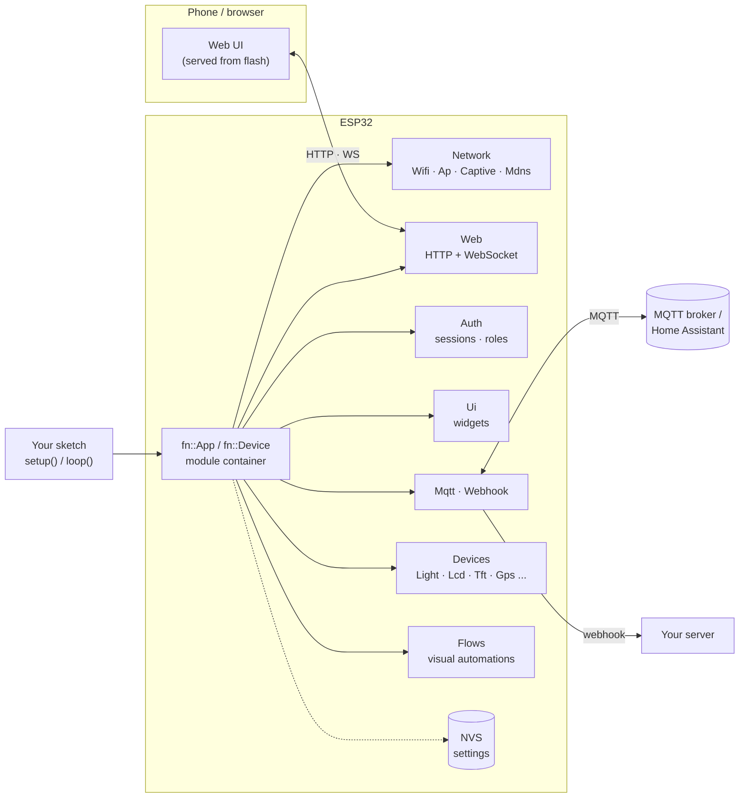
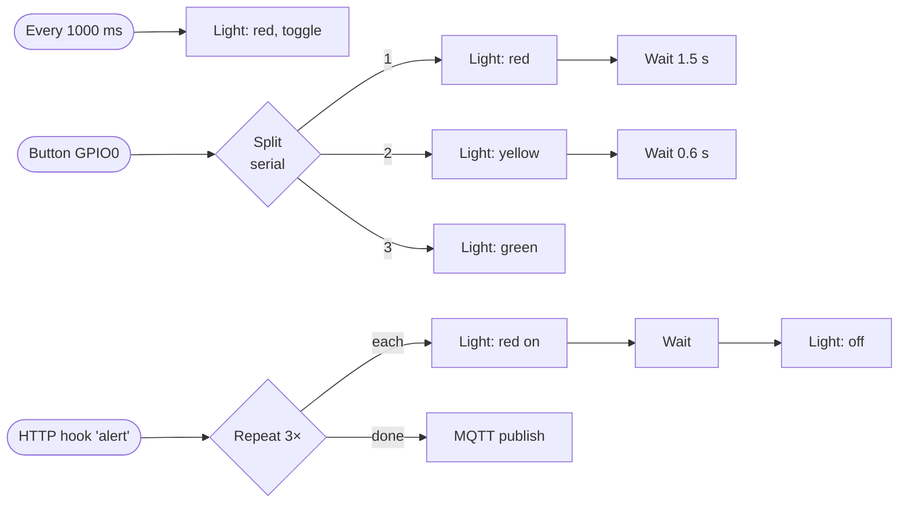

<div align="center">

# FlyghtEdge

**A web dashboard on your phone for any ESP32, in 5 lines of code.**

Wi-Fi setup portal · auto-opening captive portal · mDNS · login & sessions · drag-and-drop dashboard ·
lights & effects · visual flows · MQTT + Home Assistant · HTTP REST API · webhooks · OTA

`ESP32` · `ESP32-S2` · `ESP32-S3` · `ESP32-C3` · `ESP32-C5` · `ESP32-C6` — Arduino-ESP32 core 3.x

**English** · [Bahasa Indonesia](README.id.md)

<!-- flyght-cloud-header:start -->
> **Flyght Cloud dashboard:** [flyght.obayan.id](https://flyght.obayan.id) is the official web dashboard for these devices: one place for all your boards, from anywhere. It is optional and off by default.
<!-- flyght-cloud-header:end -->

</div>

---

## Contents

1. [Quick start](#quick-start)
2. [What you get](#what-you-get)
3. [How it fits together](#how-it-fits-together)
4. [Install](#install)
5. [Examples](#examples)
6. [Dashboard widgets](#dashboard-widgets)
7. [Lights](#lights)
8. [Visual flows](#visual-flows)
9. [Devices](#devices)
10. [Relays, sensors and motors](#relays-sensors-and-motors)
11. [License key and editions](#license-key-and-editions)
12. [Integrations: MQTT, HTTP, webhooks](#integrations)
13. [Flyght Cloud](#flyght-cloud)
14. [Modular use and your own modules](#modular-use)
15. [Documentation map](#documentation-map)
16. [Troubleshooting](#troubleshooting)
17. [License](#license)

---

## Quick start

```cpp
#include <FlyghtEdge.h>

fn::Device dev("smart-lamp");

void setup() {
  pinMode(2, OUTPUT);
  dev.page("Control").toggle("light", "Porch Light", [](bool on) { digitalWrite(2, on); });
  dev.license("fnk_live_...");  // your API key; without one: 30-minute evaluation
  dev.begin();
}

void loop() { dev.loop(); }
```

| Step | What you do                                                                                                                                                           | What happens                                                        |
| :--: | --------------------------------------------------------------------------------------------------------------------------------------------------------------------- | ------------------------------------------------------------------- |
|  1  | Upload (Partition Scheme**"No FS 4MB (2MB APP x2)"**)                                                                                                           | The board starts its own Wi-Fi`smart-lamp-XXXX`                   |
|  2  | Join that Wi-Fi from your phone                                                                                                                                       | The dashboard**opens by itself** (captive portal)             |
|  3  | Choose**I have a key** or **Set up online**                                                                                                               | Both start with the admin password                                  |
|  4  | Create the admin password                                                                                                                                             | You are signed in; the session is kept for 30 days                  |
|  5  | *I have a key:* paste it, then pick your home Wi-Fi. *Set up online:* pick your home Wi-Fi, then open the link to create a key on the Flyght website and paste it | Flyght Cloud connects once Wi-Fi is up (skip the key to stay local) |
|  6  | Open`http://smart-lamp-xxxx.local` from any device on that network                                                                                                  | The dashboard                                                       |

The key typed in the wizard connects the device to Flyght Cloud. The edition of the firmware still
comes from `dev.license()` in the sketch. The wizard saves one Wi-Fi; add backups later on the
Network page (up to 8, tried by priority).

Reconnecting or rebooting does not ask you to sign in again.

## See it

<p align="center">
  
  
</p>

<p align="center"><sub>Screenshots are from the simulator that ships with the project; it serves the same dashboard as the firmware. [Every screen, desktop and phone](docs/guides/15-screen-catalog.md).</sub></p>

## Guides

Step-by-step guides with wiring diagrams, code that compiles and screenshots are in
[docs/guides](docs/guides/README.md):
[getting started](docs/guides/01-getting-started.md) ·
[dashboard](docs/guides/02-dashboard-and-pages.md) ·
[Wi-Fi](docs/guides/03-wifi-and-provisioning.md) ·
[GPS](docs/guides/04-gps.md) ·
[TFT](docs/guides/05-tft.md) ·
[SD card](docs/guides/06-sd-card.md) ·
[LCD and IMU](docs/guides/07-lcd-and-imu.md) ·
[MCU link](docs/guides/08-mcu-link.md) ·
[MQTT and Home Assistant](docs/guides/09-mqtt-and-home-assistant.md) ·
[webhooks and flows](docs/guides/10-webhooks-and-flows.md) ·
[relays, sensors and motors](docs/guides/11-relays-sensors-motors.md) ·
[Flyght Cloud](docs/guides/12-flyght-cloud.md) ·
[wiring and pinout](docs/guides/13-wiring-and-pinout.md) ·
[troubleshooting](docs/guides/14-troubleshooting.md) ·
[screen catalog](docs/guides/15-screen-catalog.md)

## What you get

| Area                      | Features                                                                                                                                                                                            |
| ------------------------- | --------------------------------------------------------------------------------------------------------------------------------------------------------------------------------------------------- |
| **Setup & network** | Setup access point, captive portal (Android, iOS/macOS, Windows, Firefox probes + DHCP option 114), up to 8 saved Wi-Fi networks with priority and failover, mDNS`name.local`                     |
| **Login**           | Admin password (PBKDF2), HMAC-signed sessions that survive reboots, login rate limiting, optional guest access, optional users & roles                                                              |
| **Dashboard**       | Toggle, button, slider, gauge, value, chart, select, text — declared in C++. Pages, live updates over WebSocket, drag-and-drop layout stored on the device, light/dark, English + Bahasa Indonesia |
| **Lights**          | Plain LEDs (digital/PWM) and RGB LEDs (onboard pixel or 3 pins), colour picker, brightness, 12 non-blocking effects                                                                                 |
| **Visual flows**    | Node editor in the browser: triggers → logic → actions, serial or parallel branches, optional FreeRTOS thread per flow                                                                            |
| **Devices**         | BNO055 IMU, I2C LCD, SD card, TFT screen, GPS with map, external MCU over UART — each with its own page                                                                                            |
| **Integrations**    | MQTT (state/set topics, retained, LWT, Home Assistant discovery), HTTP REST with tokens, signed webhooks                                                                                            |
| **System**          | Module health, live logs, OTA update, restart, factory reset, NTP or browser clock                                                                                                                  |

## How it fits together



Every feature is an `fn::Module`. Modules declare dependencies, start in dependency order, run in
`dev.loop()`, report their health, and keep their settings in NVS. More diagrams:
[docs/ARCHITECTURE.md](docs/ARCHITECTURE.md).

## Install

| Tool        | How                                                                                                                        |
| ----------- | -------------------------------------------------------------------------------------------------------------------------- |
| Arduino IDE | *Sketch → Include Library → Add .ZIP Library…* and pick `FlyghtEdge-<version>.zip` (or Library Manager when listed) |
| arduino-cli | `arduino-cli lib install --zip-path FlyghtEdge-<version>.zip`                                                            |
| PlatformIO  | `lib_deps = flyght-ninno/FlyghtEdge` (Arduino framework, espressif32 with Arduino core 3.x)                              |

Requirements: **Arduino-ESP32 core 3.3.x**. The release package contains public headers and a
precompiled archive per chip (`src/<chip>/libFlyghtEdge.a`).

**Partition scheme (important).** A full build is 1.3–1.7 MB, more than the default 1.2 MB app
partition. Each example has a `partitions.csv` (two 1.9 MB OTA slots, no SPIFFS) and you also raise
the limit:

| Tool        | Setting                                                      |
| ----------- | ------------------------------------------------------------ |
| Arduino IDE | Tools → Partition Scheme →**No FS 4MB (2MB APP x2)** |
| arduino-cli | `--fqbn esp32:esp32:esp32s3:PartitionScheme=no_fs`         |
| PlatformIO  | `board_build.partitions = partitions.csv`                  |

## Examples

| Example              | Shows                                                                                                            | Hardware                          |
| -------------------- | ---------------------------------------------------------------------------------------------------------------- | --------------------------------- |
| `01_SmartLamp`     | Smallest app: one toggle                                                                                         | any ESP32 + LED                   |
| `02_SensorMqtt`    | Gauge, chart, slider, select, MQTT + HTTP                                                                        | any ESP32                         |
| `03_CustomModule`  | Writing your own`fn::Module`                                                                                   | any ESP32                         |
| `04_ModularApp`    | `fn::App` with only the modules you pick                                                                       | any ESP32                         |
| `05_Devices`       | IMU, LCD, SD, TFT, GPS, MCU link with per-chip pins                                                              | the devices you have              |
| `06_BuiltinLed`    | Lights, colour picker, effects, visual flows, BOOT button                                                        | **just the board**          |
| `07_Relays`        | Multi-channel relay board (active-high / low, latching), interlock, max on-time, pins movable from the card menu | a relay board                     |
| `08_Sensors`       | DHT, DS18B20, ultrasonic tank level, analog, leak switch, CO2                                                    | the sensors you have              |
| `09_Motors`        | DC motor, brushless ESC, stepper, solenoid valve                                                                 | the drivers you have              |
| `10_GpsTracker`    | GPS map, track, speed, satellites                                                                                | a GPS module                      |
| `11_GpsGeofence`   | A siren when the device leaves a circle                                                                          | GPS + relay                       |
| `12_TftStatus`     | Values on a colour screen, mirrored live                                                                         | ST7789 / ILI9341                  |
| `13_SdLogger`      | CSV logger and a file manager                                                                                    | SD card module                    |
| `14_LcdStatus`     | A 16x2 display with a backlight toggle                                                                           | I2C LCD                           |
| `15_ImuTilt`       | Pitch, roll and a tilt alarm                                                                                     | BNO055                            |
| `16_McuBridge`     | Values from and commands to another board                                                                        | any MCU on a UART                 |
| `17_DashboardTour` | All widget types, pages, sizes, roles                                                                            | **just the board**          |
| `18_HomeAssistant` | MQTT with Home Assistant discovery                                                                               | a broker                          |
| `19_WebhookAlerts` | Signed webhook on a door switch                                                                                  | a switch                          |
| `20_FlowsRules`    | Rules drawn in the browser                                                                                       | relay + button                    |
| `21_CloudClaim`    | Claim the device in Flyght Cloud                                                                                 | Wi-Fi + a key                     |
| `22_Greenhouse`    | DHT22, fan and pump with an alarm                                                                                | DHT22 + relays                    |
| `23_TankPump`      | Water level control with dry-run protection                                                                      | ultrasonic + float switch + relay |
| `24_PowerMonitor`  | Mains V/A/W/kWh with an over-current cut-off                                                                     | PZEM-004T + relay                 |

## Dashboard widgets

```cpp
dev.page("Monitor", "activity")
   .gauge("temp", "Temperature", "°C", 0, 50)
   .chart("hist", "History", "°C", 90).every(2000).size(2)
   .value("power", "Power", "W").decimals(0).icon("zap");

dev.page("Control", "sliders")
   .toggle("pump", "Pump", [](bool on) { digitalWrite(PUMP, on); })
   .slider("fan", "Fan", 0, 100, 5, [](float v) { analogWrite(FAN, v * 2.55); }).unit("%")
   .select("mode", "Mode", {"Auto", "Manual", "Away"}, [](const String& m) { /* ... */ })
   .button("bell", "Ring", [] { /* ... */ })
   .text("msg", "LCD message", [](const String& s) { /* ... */ }).role(fn::Role::Admin);

dev.ui().set("temp", 24.5);   // from loop(): pushed live to browsers, MQTT and webhooks
```

| Widget                                    | Value                      | Callback                |
| ----------------------------------------- | -------------------------- | ----------------------- |
| `toggle(id, label, cb)`                 | on/off                     | `void(bool)`          |
| `button(id, label, cb)`                 | —                         | `void()`              |
| `slider(id, label, min, max, step, cb)` | number                     | `void(float)`         |
| `select(id, label, {options}, cb)`      | text                       | `void(const String&)` |
| `text(id, label, cb)`                   | text                       | `void(const String&)` |
| `gauge(id, label, unit, min, max)`      | number (read-only)         | —                      |
| `value(id, label, unit)`                | number or text (read-only) | —                      |
| `chart(id, label, unit, points)`        | number series (read-only)  | —                      |

Modifiers apply to the widget added last: `size(1..3)`, `icon(name)`, `unit()`, `decimals()`,
`role(minRole)`, `every(ms)`. Full list: [docs/REFERENCE.md](docs/REFERENCE.md#page--widgets).

## Lights

```cpp
fn::RgbLed pixel(RGB_BUILTIN);       // onboard WS2812 (S3 / C3 / C6 DevKits)
fn::Led status(2);                   // plain LED with PWM dimming (pwm=false → digitalWrite)
fn::RgbLed strip(5, 6, 7, "desk");   // R, G, B pins (commonAnode=true if needed)
dev.use(pixel).use(status);

pixel.color(0x2563eb).brightness(60);
pixel.effect(fn::Fx::Breathe, 3000);
```

| Effect        | Colours | Default speed |  | Effect                  | Colours | Default speed |
| ------------- | :-----: | ------------: | - | ----------------------- | :-----: | ------------: |
| `solid`     |    1    |            — |  | `cycle` (two colours) |    2    |       2000 ms |
| `blink`     |    1    |       1000 ms |  | `candle`              |    1    |       1000 ms |
| `breathe`   |    1    |       3000 ms |  | `police`              |    2    |        800 ms |
| `heartbeat` |    1    |       1200 ms |  | `sos`                 |    1    |  200 ms / dot |
| `strobe`    |    1    |        120 ms |  | `sunrise`             |  auto  |          60 s |
| `rainbow`   |  auto  |       6000 ms |  | `alarm`               |    1    |        400 ms |

Effects are pure functions of `millis()`, so they never block `loop()`, and the previews on the
**Lights** page show exactly what the LED does. Each light is also on HTTP
(`/fn/api/v1/lights/<id>`), MQTT (`<base>/light/<id>/set`) and in flows. The state survives reboots.

Colours look wrong (red shows as green)? Open **Lights → Calibrate colours**: the LED shows its colours one at a
time, you pick the one you see, and the right colour order is saved. It takes three steps.

## Visual flows

```cpp
fn::Flows flows;
dev.license(FN_LICENSE_KEY);         // flows are a Pro feature (Pro key)...
dev.features().defaultOn("flows");   // ...and start switched off
dev.use(flows);
```

Open **Devices → Flows**, start from an example, drag blocks from the palette, connect the dot on
the right of a block to the dot on the left of another, press **Run**.



| Group              | Blocks                                                                                                |
| ------------------ | ----------------------------------------------------------------------------------------------------- |
| **Triggers** | Run button · On start-up · Every N ms · Widget changes · MQTT message · HTTP hook · GPIO button |
| **Logic**    | Wait · If · Repeat · Split (parallel / serial) · Set value                                        |
| **Actions**  | Log · Set widget · GPIO output · MQTT publish · HTTP request                                      |
| **Devices**  | Light · Light effect · LCD text · Screen text · Send to MCU (and blocks from your own modules)    |

* **Parallel**: several wires from one output run at the same time. **Serial**: a Split block set to
  *serial* runs output 1, then 2, then 3 (each branch with its waits finishes first).
* **Threads**: a flow runs on the main loop or, in the Enterprise edition, on its own FreeRTOS task.
* **Safety**: blocks cannot drive pins used by a module (LEDs, buses), the SPI flash or USB; timers
  are 50 ms or slower; at most 8 flows × 40 blocks, 16 runs in flight per flow.
* Text fields accept `{value}` `{uptime}` `{time}` `{id}` `{name}` (and `{base}` in MQTT topics).

## Devices

| Bus         | Module                       | Page   | What you get                                          |
| ----------- | ---------------------------- | ------ | ----------------------------------------------------- |
| I2C         | `fn::Bno055 imu;`          | Motion | Horizon, compass, 3D box, calibration, "set as level" |
| I2C         | `fn::LcdI2c lcd(16, 2);`   | LCD    | Live mirror, write rows, backlight, I2C scanner       |
| SPI / SDMMC | `fn::SdCard sd(cs);`       | Files  | Browse, upload, download, rename, delete, preview     |
| SPI         | `fn::Tft tft(panel);`      | Screen | Pixel-exact mirror and drawing tools                  |
| UART        | `fn::Gps gps(rx, tx);`     | Map    | Leaflet map, track, speed, satellites, GPX export     |
| UART        | `fn::McuLink mcu(rx, tx);` | Serial | Console, telemetry as live values, quick buttons      |
| GPIO        | `fn::Led` / `fn::RgbLed` | Lights | Colour picker, brightness, effects                    |

Nothing of a device is linked unless you create it and call `dev.use(...)`. Pins:
`imu.pins(sda, scl)`, `sd.pins(sck, miso, mosi)`, `panel.pins(sck, mosi, miso)`; `examples/05_Devices`
has defaults for every chip.

## Relays, sensors and motors

For the usual IoT parts there are ready modules. Each one is a card (or several) on the dashboard, is
linked into the firmware only when you create it, and works over MQTT, Home Assistant, flows and
Flyght Cloud like any other widget. See `examples/07_Relays`, `08_Sensors`, `09_Motors`.

| Part                                | Module                | Notes                                                                                                        |
| ----------------------------------- | --------------------- | ------------------------------------------------------------------------------------------------------------ |
| Relay board, 1-16 channels          | `fn::Relay`         | active-high, active-low, latching (set + reset pin); boot state, pulse, maximum on-time, interlock group     |
| Solenoid valve                      | `fn::Solenoid`      | a relay that closes by itself and rests between openings                                                     |
| DHT11 / DHT22                       | `fn::Dht`           | temperature + humidity, one pin                                                                              |
| DS18B20                             | `fn::Ds18b20`       | one sensor on a 1-Wire pin, 4.7 k pull-up                                                                    |
| Ultrasonic (HC-SR04, JSN-SR04T)     | `fn::Ultrasonic`    | distance, optional tank level in %, air-temperature correction                                               |
| Water level, O2, H2, MQ gas, ACS712 | `fn::AnalogSensor`  | any analog output: linear scale, Hall current, MQ curve. ADC1 pins only                                      |
| Float switch, water leak, flame     | `fn::DigitalSensor` | debounced, active-low, your own labels                                                                       |
| CO2                                 | `fn::Mhz19`         | MH-Z19 over UART                                                                                             |
| Mains power meter                   | `fn::Pzem`          | PZEM-004T v3 over UART: V, A, W, kWh, Hz, power factor                                                       |
| DC voltage / current / power        | `fn::Ina219`        | I2C                                                                                                          |
| Brushed DC motor                    | `fn::DcMotor`       | H-bridge (L298N, TB6612, L9110 ...): speed -100..100 %, a reversal goes through zero, ramp, maximum run time |
| Brushless motor                     | `fn::Esc`           | through an ESC: arms first, then throttle 0..100 %                                                           |
| Stepper                             | `fn::Stepper`       | step/dir drivers (A4988, DRV8825, TB6600): move to a position with acceleration                              |

```cpp
fn::Relay relays("relay", "Pump room");
fn::Dht dht(4);

void setup() {
  relays.channel(5, "Pump").maxOn(600);          // off by itself after 10 minutes
  relays.channel(6, "Valve", fn::Relay::Type::ActiveLow);
  dht.every(5000).alarm(35, 32);                 // an "alarm" card: on at 35 C, off at 32 C
  dev.use(relays).use(dht);
  dev.begin();
}
```

**Move a pin without recompiling.** On every card that belongs to one of these modules an admin sees a
three-dots menu with **Settings**. The dialog lists the pins of the device, named by what they do
(GPIO output, analog ADC1, UART RX, I2C SDA, step ...), and offers only pins that can work: no flash or
USB pins, no input-only pin for an output, ADC1 pins for analog inputs, pins used by another device
shown as taken, boot pins with a warning. A device that switches a load (relay, motor, stepper)
asks for the device name before it saves; GPIO pins apply at once (the output is switched off before
the pin moves), UART and I2C pins are used from the next start. A saved pin wins over the one in
the sketch.

**Good to know**

* A reading that cannot be trusted shows "—", never a plausible number. A sensor with no valid reading
  for five intervals goes to *degraded* in the module health.
* Calibration is yours. A gas sensor shows what its curve says; check it against a reference.
* Wiring: HC-SR04 echo is 5 V (use a divider), a relay board needs its own supply and a flyback diode on
  every coil, the analog pins are 0-3.1 V, ADC2 pins are not offered because they stop working with Wi-Fi.
* A DHT read takes about 5 ms with interrupts off, once per interval. The stepper runs up to a few thousand
  steps a second. Neither blocks the dashboard.
* **Not a safety function.** Interlocks, maximum on-times and the Stop cards are conveniences; an
  emergency stop belongs in hardware.

---

## License key and editions

Every build needs a **license key (API_KEY)**: `fnk_live_` followed by about 150-180 characters.
The key says who it belongs to and which edition it unlocks. It is signed by flyght-ninno with
**ECDSA P-256** and checked **offline** on the board at boot, so it cannot be edited or forged,
and no internet connection is needed. Free keys are free; Pro and Enterprise keys come with the
commercial license and cover the releases published until their update date.

```cpp
// secrets.h, next to the sketch and kept out of version control:
#define FN_LICENSE_KEY "fnk_live_..."

dev.license(FN_LICENSE_KEY);             // before dev.begin()
```

| Situation                                                                                | What happens                                                                                                                                         |
| ---------------------------------------------------------------------------------------- | ---------------------------------------------------------------------------------------------------------------------------------------------------- |
| Valid key                                                                                | Its edition is used;*Settings → Plan & features* shows "Licensed to …"                                                                           |
| No key, a mistyped, revoked or forged key, or a release newer than the key's update date | **Evaluation mode**: every feature on, a banner in the dashboard, and after **30 minutes** the app stops (HTTP 402) until the next reset |

The boot log says which case applies and why. The examples read the key from `secrets.h` when
the file exists. On a product, turn on Flash Encryption so the key cannot be read from a flash dump.

### Feature switches

| Feature                                            | id             | Edition    |   Default   |
| -------------------------------------------------- | -------------- | ---------- | :----------: |
| Guest access (no password)                         | `guest`      | Free       |     off     |
| API tokens for other systems                       | `apiTokens`  | Free       | **on** |
| Visual flows                                       | `flows`      | Pro        |     off     |
| Users & roles (viewer / operator / admin accounts) | `rbac`       | Pro        |     off     |
| White label (hide branding)                        | `whitelabel` | Pro        |     off     |
| Flows on RTOS threads                              | `flowsRtos`  | Enterprise |     off     |

```cpp
dev.features().defaultOn("rbac");        // first-boot default; later: Settings → Plan & features
if (dev.features().on("rbac")) { ... }   // allowed by the edition AND switched on
```

## Integrations

**MQTT** — base topic `flyght/{id}` by default.

| Topic                       | Direction | Payload                                                       |
| --------------------------- | --------- | ------------------------------------------------------------- |
| `<base>/status`           | device → | `online` / `offline` (retained, LWT)                      |
| `<base>/state/<widget>`   | device → | `ON`/`OFF`, number or text                                |
| `<base>/set/<widget>`     | → device | same, plus`toggle` and `PRESS`                            |
| `<base>/light/<id>/set`   | → device | `ON`, `OFF`, `TOGGLE`, `#rrggbb`, effect name or JSON |
| `<base>/light/<id>/state` | device → | JSON state (retained)                                         |

**HTTP** — every endpoint in [docs/API.md](docs/API.md).

```bash
curl -H "Authorization: Bearer $TOKEN" http://smart-lamp-c2d3.local/fn/api/v1/state
curl -X POST -H "Authorization: Bearer $TOKEN" -H "Content-Type: application/json" \
     -d '{"light": true, "fan": 40}' http://smart-lamp-c2d3.local/fn/api/v1/state
curl -X POST -H "Authorization: Bearer $TOKEN" http://smart-lamp-c2d3.local/fn/api/v1/flows/hook/alert
```

**Webhook** — JSON POST on change or on an interval, signed with HMAC-SHA256 (`X-Flyght-Signature`).

## Flyght Cloud

Flyght Cloud lists this device next to your others on the web and lets you watch and control it
from anywhere. It is **off by default**: the device works the same without it, and the local
dashboard, MQTT and webhooks are not affected.

```cpp
dev.license("fnk_live_...");   // the same key registers the device
dev.cloud().enable();          // or switch it on in Settings > Flyght Cloud
```

1. The device registers itself with its license key and is told where to connect.
2. It connects over TLS (the server's certificate is verified) and mirrors the dashboard: widget
   states go up, commands from the web come down. Lights are not mirrored yet.
3. In **Settings > Flyght Cloud** (admin) you see the status and, until the device is registered,
   the link that claims it in your Flyght account.

| Status                                    | Meaning                                                                                                                        |
| ----------------------------------------- | ------------------------------------------------------------------------------------------------------------------------------ |
| Off                                       | Not switched on                                                                                                                |
| No network                                | Waiting for Wi-Fi                                                                                                              |
| Needs a license key                       | No key in the sketch or the dashboard, or the server does not accept it                                                        |
| Claiming / Fetching settings / Connecting | On its way                                                                                                                     |
| Online                                    | Connected                                                                                                                      |
| Retrying                                  | Server busy or unreachable; tries again with a growing pause                                                                   |
| Stopped                                   | The server refused this device (key revoked, device blocked, owned by another account, no free slot); the dashboard says which |

**Server address.** The firmware carries one address, `https://flyght.obayan.id`. It is not a
setting on the device: the dashboard shows it, and the local API refuses a `site` sent to
`PUT /fn/api/v1/cloud` (403). A build of your own points somewhere else with
`dev.cloud().site("https://your.server")` or `-DFN_CLOUD_SITE=...`. Everything else (broker, topics)
comes from the server, so a device follows the server when it moves, and goes back to the built-in
address if the one the server named stops answering. Only `https://` addresses are accepted.

The license key is write-only: the dashboard and the API tell you whether a key is set, never what it is.
The local MQTT module is independent, so your own broker or Home Assistant keeps working.

---

## Modular use

```cpp
fn::App app("field-meter");
fn::Web web;  fn::Auth auth;  fn::System sys;  fn::Ap ap;  fn::Captive captive;  fn::Mdns mdns;  fn::Ui ui;
app.use(web).use(auth).use(sys).use(ap).use(captive).use(mdns).use(ui);
app.begin();
```

A module of your own needs `id()` and `begin()`; `loop()`, `deps()`, `health()` and flow blocks are
optional. See [docs/MODULES.md](docs/MODULES.md) and `examples/03_CustomModule`.

## Documentation map

| Document                                    | For                                                                 |
| ------------------------------------------- | ------------------------------------------------------------------- |
| [docs/guides](docs/guides/README.md)         | Step-by-step guides with wiring diagrams, GPIO maps and screenshots |
| [docs/REFERENCE.md](docs/REFERENCE.md)       | Every class and function you call from a sketch, with tables        |
| [docs/ARCHITECTURE.md](docs/ARCHITECTURE.md) | Block diagrams: modules, boot, requests, sessions, flows, threads   |
| [docs/API.md](docs/API.md)                   | HTTP endpoints, WebSocket topics, webhook payload                   |
| [docs/MODULES.md](docs/MODULES.md)           | Writing modules, UI pages and flow blocks                           |
| [CHANGELOG.md](CHANGELOG.md)                 | What changed                                                        |

## Troubleshooting

| Symptom                                               | Fix                                                                           |
| ----------------------------------------------------- | ----------------------------------------------------------------------------- |
| "Sketch too big"                                      | Partition Scheme →*No FS 4MB (2MB APP x2)*                                 |
| Nothing on Serial with native USB boards              | Tools →*USB CDC On Boot: Enabled*                                          |
| Phone does not open the page by itself                | Open`http://192.168.4.1` manually; some phones need mobile data off         |
| `name.local` does not resolve                       | Use the IP shown on the Wi-Fi page (Android before 12 has no mDNS)            |
| A flow cannot be saved: "GPIO N is used by …"        | That pin belongs to an LED, a bus, the flash or USB; pick another pin         |
| Red and green swapped on an RGB LED                   | Lights page → **Calibrate colours** (pick what you see, three steps), or `led.colorOrder(fn::ColorOrder::RGB)` |
| `#error ... built for the ESP32 Arduino core 3.3.x` | Install that core version in Boards Manager                                   |

## License

**FlyghtEdge Community License 1.1** — free to build and ship firmware with it, including
commercial products, with a license key; the library itself may not be redistributed, modified for redistribution,
reverse engineered, used to build a competing library, or run with its license check bypassed.
Pro/Enterprise features in shipped products need a commercial license. See [LICENSE](LICENSE) and [NOTICE](NOTICE).

Bundled third-party assets: Montserrat (SIL OFL 1.1), Leaflet 1.9.4 (BSD-2-Clause, only with
`fn::Gps`). Map tiles © OpenStreetMap contributors.

© 2026 flyght-ninno

<!-- flyght-cloud-footer:start -->
---

**Flyght Cloud.** See this device next to your others, from anywhere: [flyght.obayan.id](https://flyght.obayan.id). Sign in, claim the device with its link, and the dashboard you built here is also on the web.
<!-- flyght-cloud-footer:end -->

---

<!-- flyght-contact:start -->
## Get in touch

Questions, a bug, an idea, or a project of your own? Reach out at **[ninno.obayan.id](https://ninno.obayan.id)**:

- **Contribute**: code, examples, documentation, translations and hardware reports are welcome.
- **Commercial use**: licensing, support and custom work for products and fleets.
- **Donate**: if FlyghtEdge saves you time, you can help keep it going.
<!-- flyght-contact:end -->
