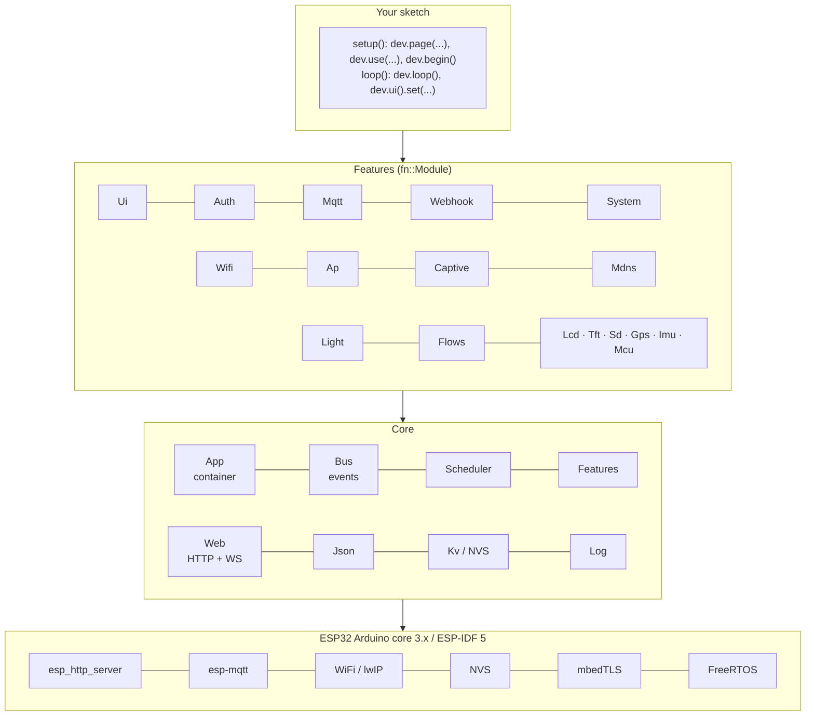
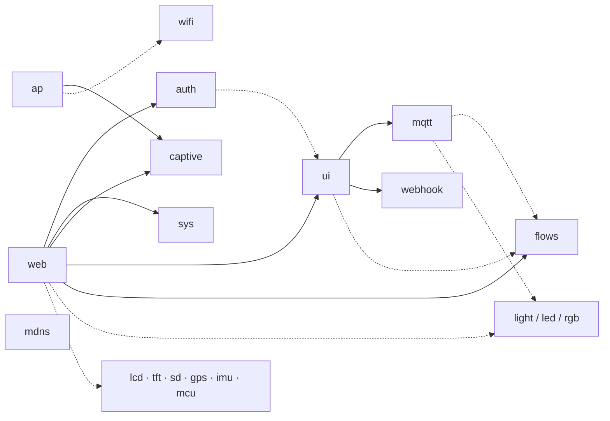
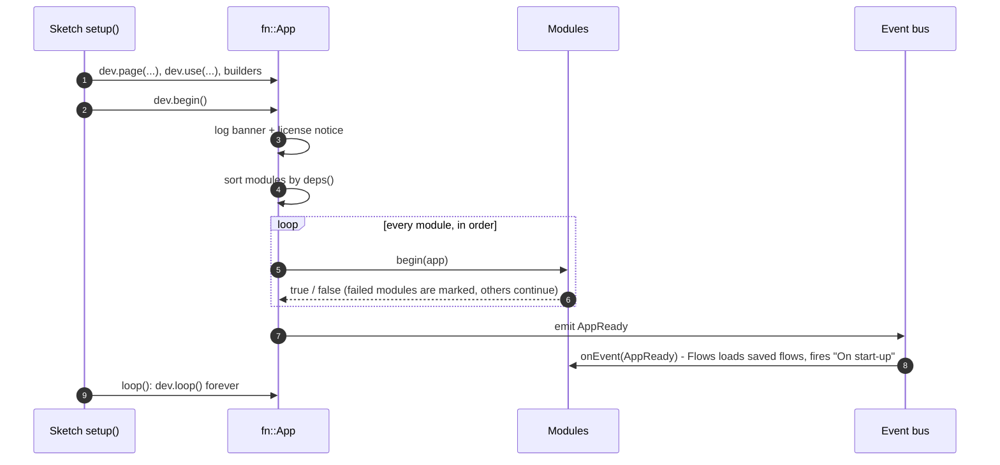
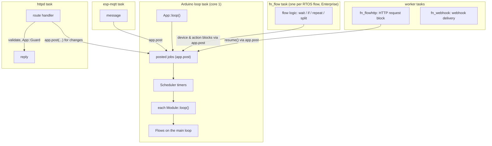
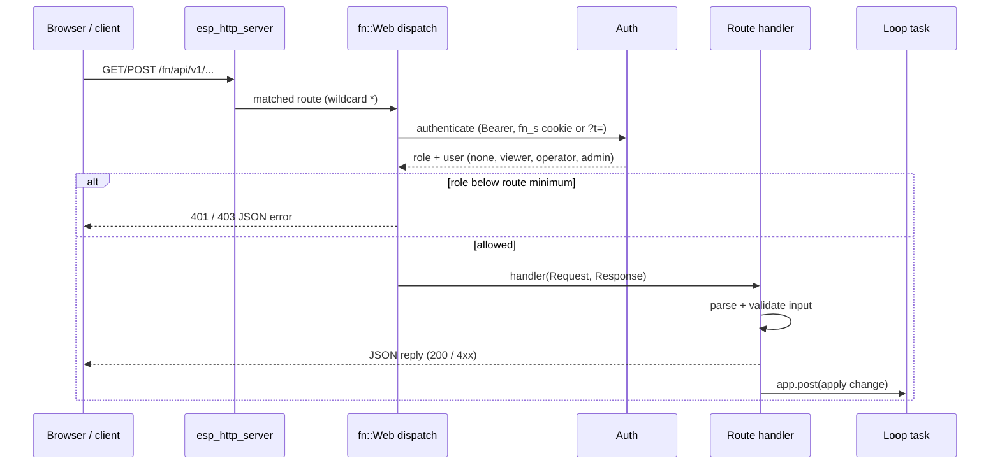
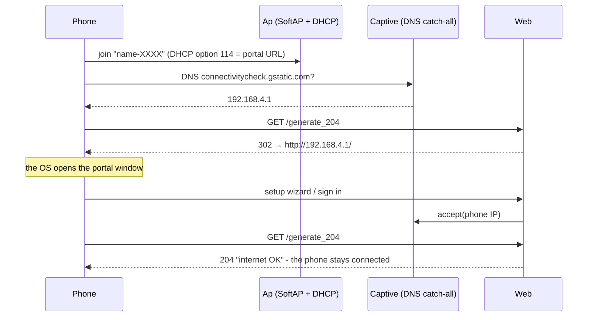
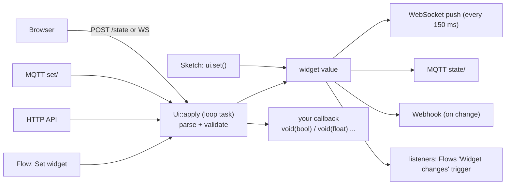
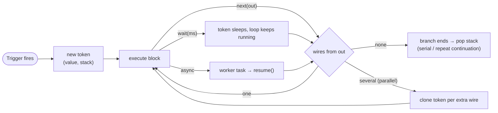
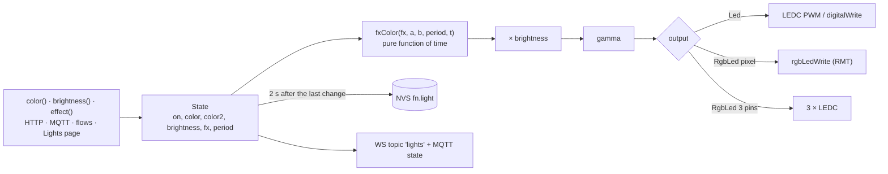
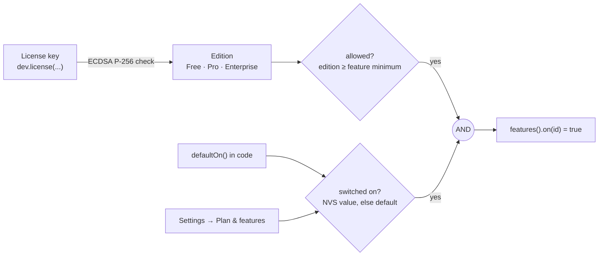

# Architecture

Block diagrams of how FlyghtNinno works inside the ESP32. The diagrams are Mermaid (GitHub and
most Markdown viewers render them).

**Contents** — [Layers](#1-layers) · [Modules and dependencies](#2-modules-and-dependencies) ·
[Boot sequence](#3-boot-sequence) · [Tasks and threads](#4-tasks-and-threads) ·
[HTTP request path](#5-http-request-path) · [First connection: captive portal](#6-first-connection-captive-portal) ·
[Sessions and roles](#7-sessions-and-roles) · [A widget change](#8-a-widget-change) ·
[Visual flows engine](#9-visual-flows-engine) · [Lights](#10-lights) · [Storage](#11-storage-nvs) ·
[Editions](#12-editions-and-feature-switches) · [Release packaging](#13-release-packaging) · [Limits](#14-limits)

---

## 1. Layers



No external Arduino libraries: everything below the core layer ships with the ESP32 core.

## 2. Modules and dependencies



Solid arrow = required, dotted = optional (`?` in `deps()`). `App::begin()` sorts modules
topologically, so `dev.use(...)` order never matters. A module whose required dependency failed is
skipped; the rest keep running.

## 3. Boot sequence



## 4. Tasks and threads



Rule of thumb: **state changes always happen on the loop task**. Other tasks validate, then post
the work there. `App::Guard` protects data read by the HTTP task (widget values, lists).

## 5. HTTP request path



## 6. First connection: captive portal



## 7. Sessions and roles

```mermaid
flowchart LR
    LOGIN["POST /auth/login<br/>(password, username?)"] --> CHECK{"owner / account / guest?"}
    CHECK -->|owner| T0["token uid=0, role admin"]
    CHECK -->|account (rbac on)| T1["token uid=1..254, role from account"]
    CHECK -->|guest (guest on)| T2["token uid=255, guest role"]
    T0 & T1 & T2 --> SIGN["HMAC-SHA256(role.uid.sid.exp.epoch)<br/>key = per-device secret in NVS"]
    SIGN --> COOKIE["cookie fn_s / Bearer"]
    COOKIE --> REQ["each request: verify signature, expiry, epoch"]
    REQ --> ROLE["role: owner = admin; account = its CURRENT role;<br/>guest = current guest role; switched off = signed out"]
```

Sign out everywhere increases the epoch, which invalidates every token at once.

## 8. A widget change



## 9. Visual flows engine

A flow is a graph of blocks. A **run** is a token that walks the graph.



| Situation | What the engine does |
|---|---|
| One output, several wires | **Parallel**: one token per wire, all advance together |
| Split block, mode *serial* | Outputs 1, 2, 3 run one after another; the continuation is pushed on the token's stack |
| Repeat N | Runs `each` N times (the block re-enters itself through the stack), then `done` |
| Wait | Non-blocking: the token stores a wake-up time |
| HTTP request | Runs on `fn_flowhttp`, the token resumes when the reply arrives |
| Step budget | At most 48 block steps per loop pass, so a loop without a Wait cannot freeze the device |
| RTOS flow | Logic runs on its own task; device and action blocks are posted to the loop task |
| Pins | Saving fails if a GPIO block uses a pin owned by a module, the flash or USB |

## 10. Lights



The loop renders 50 frames per second and only writes the LED when the colour changed. The web
previews run the same `fxColor` maths in JavaScript, so they match the LED exactly.

## 11. Storage (NVS)

| Namespace | Owner | Contents |
|---|---|---|
| `fn.sys` | App | display name, hostname |
| `fn.auth` | Auth | password hash + salt, session secret, epoch, guest role, session days, API tokens, accounts |
| `fn.feat` | Features | switches changed in Settings |
| `fn.wifi` | Wifi | up to 8 networks with priority |
| `fn.ap` | Ap | SSID, password, mode, channel |
| `fn.ui` | Ui | dashboard layout (order, sizes, hidden) |
| `fn.mqtt` | Mqtt | broker, credentials, base topic, options |
| `fn.hook` | Webhook | URL, secret, interval |
| `fn.light` | Light | last state of each light |
| `fn.flows` | Flows | index + one blob per flow |
| `fn.imu` · `fn.tft` · `fn.mcu` | devices | calibration and settings |

*Factory reset* erases every `fn.*` namespace. Values in code are only first-boot defaults.

## 12. Editions and feature switches

The edition comes from the license key only. `App::begin()` verifies the key (ECDSA P-256 /
SHA-256 with mbedTLS, against the public keys compiled into the archive) before any module
starts. No key or a rejected key means evaluation mode: every edition for 30 minutes, then
`App::loop()` stops running modules and the web server answers 402 to everything but
`/auth/state`, until the next reset.



`on()` is cached in RAM, so modules can check it on every request and loop pass.

## 13. Release packaging

The library is delivered as public headers plus one precompiled archive per chip
(`src/<mcu>/libFlyghtEdge.a` for ESP32, S2, S3, C3, C5 and C6), together with the examples and
the documentation (`library.properties` has `precompiled=full`). Each archive is tied to the
ESP32 core major.minor it was built for, which is checked when your sketch compiles.

## 14. Limits

| Item | Limit |
|---|---|
| Saved Wi-Fi networks | 8 |
| API tokens | 8 |
| User accounts | 8 |
| HTTP routes + assets | 128 handlers |
| HTTP sockets | 8 (oldest idle one is recycled) |
| Flows | 8 flows × 40 blocks × 80 wires, 16 runs in flight per flow |
| Flow interval trigger | ≥ 50 ms |
| Text widget | 128 characters |
| Log ring buffer | last lines kept in RAM (System page) |
