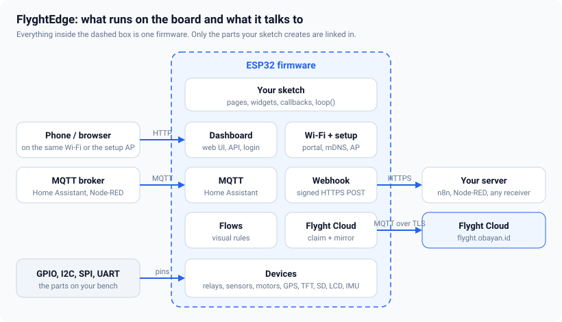

# Getting started

This guide takes you from an empty board to a dashboard on your phone. It needs about fifteen minutes
and one ESP32 board. You do not need any other parts yet.



## What you need

- An ESP32 board: ESP32, ESP32-S2, ESP32-S3, ESP32-C3, ESP32-C5 or ESP32-C6.
- The Arduino IDE 2.x (or `arduino-cli`) with the **esp32 by Espressif** board package, version 3.x.
- A USB cable that carries data, not only power.

## Install the library

1. Download the library as a ZIP file.
2. In the Arduino IDE choose **Sketch → Include Library → Add .ZIP Library…** and pick the file.
3. Open **File → Examples → FlyghtEdge → 01_SmartLamp**.

Before you upload, choose the board under **Tools → Board → esp32**, and set
**Tools → Partition Scheme** to **No FS 4MB (2MB APP x2)**. FlyghtEdge keeps all of its settings in the
chip's flash storage, so it needs no file system partition, and two application slots leave room for
over-the-air updates.

## The first sketch

This is the whole of `01_SmartLamp`, trimmed to what matters:

<!-- example: 01_SmartLamp -->
```cpp
#include <FlyghtEdge.h>

const int LED_PIN = 2;  // change to your board's LED pin

fn::Device dev("smart-lamp");

void setup() {
  Serial.begin(115200);
  pinMode(LED_PIN, OUTPUT);

  dev.page("Control", "home")
      .toggle("light", "Porch Light", [](bool on) { digitalWrite(LED_PIN, on); }).icon("bulb")
      .gauge("temp", "Room Temperature", "°C", 0, 50).icon("thermo");

  dev.license(FN_LICENSE_KEY);

  dev.begin();
}

void loop() {
  dev.loop();
}
```

Three things are worth knowing:

- `fn::Device` is the whole application. It starts the Wi-Fi, the web server, the login, the dashboard
  and MQTT for you. You describe *what* is on the dashboard; you do not write routes or HTML.
- A **page** holds **widgets**. Each widget has an id (`"light"`), a label and, for the ones you can
  change, a callback that runs when someone changes it, from the dashboard, from MQTT or from the API.
- `dev.loop()` must run often. Do not block in `loop()` with long `delay()` calls.

## First boot

1. Upload the sketch. The board starts its own Wi-Fi network called `smart-lamp-XXXX`.
2. Join that network from your phone. The dashboard opens by itself (a "captive portal", like a hotel
   Wi-Fi page). If it does not, open `http://192.168.4.1`.
3. The setup wizard asks how you want to set up the device:

   

   - **I have a key**: create the admin password, paste your license key, then pick your home Wi-Fi.
   - **Set up online**: create the password, connect to Wi-Fi, then follow the link that creates a key
     on the Flyght website and paste it back.

   Either way the password comes first, because the setup network is open until you set one. You can skip
   the key and add it later in **Settings → Flyght Cloud**.
4. Pick your home Wi-Fi from the list and enter its password. The wizard shows the addresses to use
   next. From any device on that Wi-Fi, open `http://smart-lamp-xxxx.local`.


> The screenshots in these guides are desktop views from the simulator that ships with the project. It
> serves the same dashboard as the firmware, so they match what you will see. The [screen
> catalog](15-screen-catalog.md) shows every screen on a desktop and on a phone.

## About the license key

The key goes into the sketch with `dev.license("fnk_live_...")`, ideally from a `secrets.h` file that is
not committed. Without a key the device runs in evaluation mode: everything is on, and the application
stops after 30 minutes per boot. The key is checked on the device, without any network.

## Where to go next

| You want to | Read |
|---|---|
| Understand widgets, pages and layout | [Dashboard and pages](02-dashboard-and-pages.md) |
| Add backup Wi-Fi networks, change the setup network | [Wi-Fi and provisioning](03-wifi-and-provisioning.md) |
| Add a GPS, a screen, an SD card, a display, an IMU | [GPS](04-gps.md), [TFT](05-tft.md), [SD card](06-sd-card.md), [LCD and IMU](07-lcd-and-imu.md) |
| Drive relays, read sensors, run motors | [Relays, sensors and motors](11-relays-sensors-motors.md) |
| Reach the device from anywhere | [Flyght Cloud](12-flyght-cloud.md) |
| Wire it without guessing | [Wiring and pinout](13-wiring-and-pinout.md) |
| Fix something that does not work | [Troubleshooting](14-troubleshooting.md) |

<!-- flyght-cloud-footer:start -->
---

**Flyght Cloud.** See this device next to your others, from anywhere: [flyght.obayan.id](https://flyght.obayan.id). Sign in, claim the device with its link, and the dashboard you built here is also on the web.
<!-- flyght-cloud-footer:end -->
