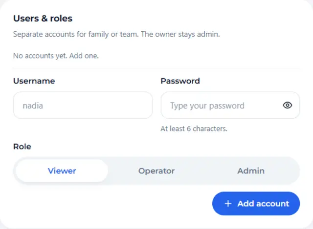
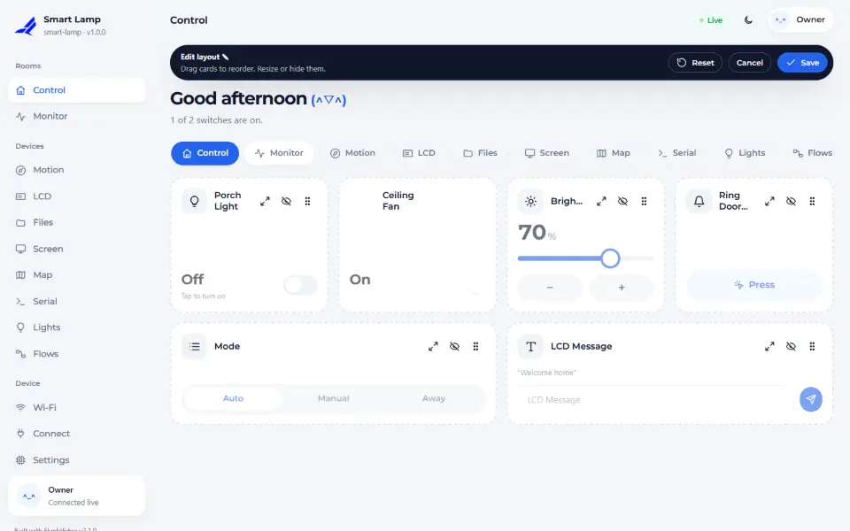

# Dashboard and pages

The dashboard is built from what your sketch declares. This guide explains the eight widget types, how
pages and layout work, and how a change travels from a finger on the screen to your code and back.

## Widgets

| Type | Method | What it is for | Can the user change it? |
|---|---|---|---|
| Toggle | `toggle(id, label, callback)` | on / off: a lamp, a pump | yes |
| Button | `button(id, label, callback)` | a one-shot action: ring a bell, start a cycle | yes |
| Slider | `slider(id, label, min, max, step, callback)` | a number in a range: brightness, speed | yes |
| Select | `select(id, label, {options}, callback)` | one of a few choices: a mode | yes |
| Text | `text(id, label, callback)` | a short text: a message for a display | yes |
| Gauge | `gauge(id, label, unit, min, max)` | a number on a dial: temperature, level | no |
| Value | `value(id, label, unit)` | a plain number or word: uptime, state | no |
| Chart | `chart(id, label, unit, points)` | a number over time | no |

Modifiers apply to the widget you just added: `.icon("thermo")`, `.unit("%")`, `.decimals(1)`,
`.size(1..3)` (columns), `.role(fn::Role::Admin)` and, for charts, `.every(ms)`.

<!-- example: 17_DashboardTour -->
```cpp
dev.page("Controls", "sliders")
    .toggle("lamp", "Lamp", [](bool on) { Serial.printf("lamp %s\n", on ? "on" : "off"); }).icon("bulb")
    .button("ping", "Ping", [] { Serial.println("ping!"); }).icon("bell")
    .slider("level", "Level", 0, 100, 5, [](float v) { Serial.printf("level %.0f\n", v); }).unit("%").size(2).icon("sliders")
```

## Showing a value

Anything the user cannot change is yours to update. Call `dev.ui().set(id, value)` whenever you have a
new reading. It accepts numbers, booleans and text, and it is cheap: the dashboard only receives what
changed.

<!-- example: 17_DashboardTour -->
```cpp
const float t = millis() / 1000.0f;
dev.ui().set("temp", 25.0f + 8.0f * sinf(t / 20.0f));
dev.ui().set("uptime", (unsigned long)(millis() / 1000));
```

## One callback, every source

The callback of a toggle or slider runs whether the change came from the dashboard, from an MQTT
message, from the HTTP API, from a flow or from Flyght Cloud. You write the behaviour once. If you need
to know where a change came from, the device log records the source of each change (`web`, `mqtt`,
`http`, `cloud`, or `code` for your own sketch and flows).

## Who may change what

There are three roles: **viewer** (look only), **operator** (change widgets) and **admin** (settings
and users). Every widget can be limited with `.role(...)`. Guest access is off by default; you can turn
it on in the setup wizard or later in **Settings → Security**. With the user accounts feature, named
people get their own role.



## Layout

Admins can reorder cards by dragging, change their size and hide them. The layout is stored on the
device and is the same for everyone who opens that page.



The menu is the same on every screen size. On a phone it is hidden until you press the menu button in the top
bar, then it slides in with the rooms, the device pages (Lights, Flows, Files and so on), Wi-Fi, Connect and Settings.

The dashboard follows the phone's light or dark setting, and has an English and an Indonesian
interface that you can switch at any time.


## Limits worth knowing

- Widget ids are 1 to 32 characters of letters, digits, `_` and `-`. Flyght Cloud ignores ids it
  cannot accept, and the device logs a warning at start-up when it finds one.
- A callback runs on the main loop. Keep it short; start a timer or set a flag for long work.
- `dev.ui().set()` belongs on the loop task. From another task use `dev.post(...)`.

See the [C++ reference](../REFERENCE.md) for every method and the [API](../API.md) for the HTTP routes.

<!-- flyght-cloud-footer:start -->
---

**Flyght Cloud.** See this device next to your others, from anywhere: [flyght.obayan.id](https://flyght.obayan.id). Sign in, claim the device with its link, and the dashboard you built here is also on the web.
<!-- flyght-cloud-footer:end -->
