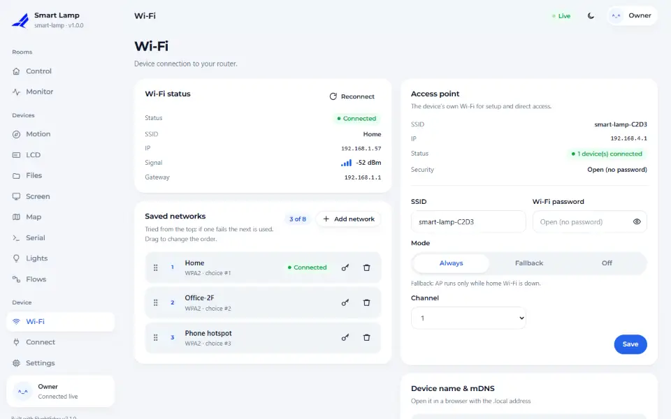

# Wi-Fi and provisioning

A device that is not set up yet has no network to join. FlyghtEdge solves that with its own setup
network, a captive portal and a short wizard. This guide covers how that works, how to keep several
Wi-Fi networks, and how to change the defaults.

## How a device gets online

1. **Setup network.** With no saved Wi-Fi, or when the saved one cannot be reached, the board starts
   an access point named `<name>-XXXX` (the last four digits come from the chip's MAC address).
2. **Captive portal.** Phones check for internet right after joining a Wi-Fi. The device answers those
   checks by sending the phone to the dashboard, so the setup page opens by itself.
3. **Wizard.** You set the admin password first, because the setup network is open until then, and
   then choose a Wi-Fi network.
4. **Station mode.** The board joins your Wi-Fi. The setup network stays available as a fallback and
   can be turned off in **Wi-Fi → Access point**.



## Several networks

A device can remember up to **eight** networks, for example home, office and a phone hotspot.

- They are tried **in order of priority**; drag them to change the order.
- If the first one fails (wrong password, out of range) the device moves on to the next one.
- Reconnecting uses a growing pause (15 seconds up to 15 minutes) so a missing router does not keep
  the radio busy.
- When you add a network while you are connected, you can choose to save it as a backup without
  switching to it now.

You can also set networks in code. They are first-boot defaults; the ones you save in the dashboard win.

```cpp
dev.wifi().add("HomeWiFi", "home-password", 90);   // higher number: tried first
dev.wifi().add("OfficeWiFi", "office-password", 50);
```

## Changing the setup network

```cpp
dev.ap().ssid("greenhouse-{mac4}").password("12345678");   // "" = an open network (the default)
```

`{name}` and `{mac4}` are replaced with the device name and the last four hex digits of the MAC address.
A password must be at least eight characters. With a password the phone asks for it before the portal
opens, which is what you want for a device that stays installed.

## Reaching the device later

- `http://<hostname>.local` works on most phones and computers (mDNS). Android is the exception on some
  versions; use the IP address shown in the wizard or in **Wi-Fi**.
- The hostname is the device name with the last four MAC digits; change it under
  **Wi-Fi → Device name & mDNS**.
- If you lose the Wi-Fi, the setup network comes back by itself and you can pick another one.

## Starting over

**Settings → Maintenance → Factory reset** erases every setting, the saved networks and the admin
password; it asks you to type `RESET`. The device then behaves like a new one.

<!-- flyght-cloud-footer:start -->
---

**Flyght Cloud.** See this device next to your others, from anywhere: [flyght.obayan.id](https://flyght.obayan.id). Sign in, claim the device with its link, and the dashboard you built here is also on the web.
<!-- flyght-cloud-footer:end -->
