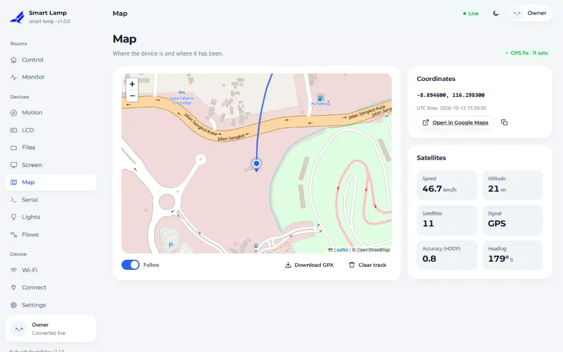
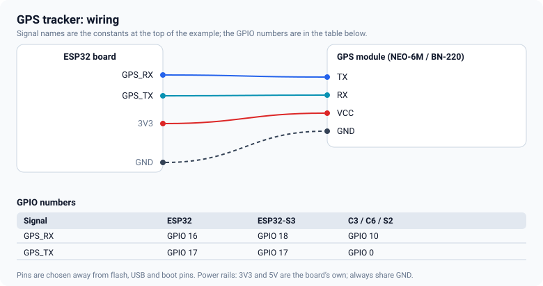
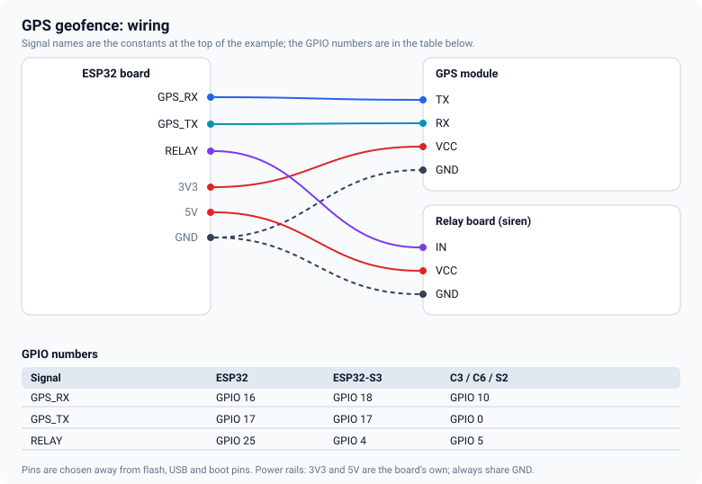

# GPS

A GPS module gives the dashboard a live map, a recorded track, speed, altitude and the time. This guide
wires a module to a UART and shows two sketches: a tracker and a geofence.



## What you need

Any NMEA GPS module with a 3.3 V serial output: u-blox NEO-6M, NEO-7M, NEO-8M, BN-220 and similar. They
speak 9600 baud by default, which is what the library expects.

## Wiring



The module's **TX goes to the ESP32's RX pin** and its RX to the ESP32's TX. Share ground. The numbers
for your chip are in the [pin tables](pin-tables.md). If the module's board has a regulator you can power
it from 5 V; the serial lines stay at 3.3 V.

## The sketch

`10_GpsTracker` is short. The module is a UART device, so you give it a pin pair and a serial port:

<!-- example: 10_GpsTracker -->
```cpp
fn::Device dev("gps-tracker");
fn::Gps gps(GPS_RX, GPS_TX, 9600, Serial1);

void setup() {
  Serial.begin(115200);

  gps.track(600, 5)        // keep up to 600 points, add one every 5 m
      .setClock(true);     // set the device clock from the GPS time
```

`track(points, minMeters)` keeps a ring of the most recent points and adds a new one only after the
device has moved a few metres, so a parked device does not fill the track with noise. `setClock(true)`
uses the GPS time for the device clock, which gives you correct timestamps without Wi-Fi.

Read the position in `loop()`:

<!-- example: 10_GpsTracker -->
```cpp
const auto& f = gps.fix();
dev.ui().set("sats", (int)f.sats);
if (gps.hasFix()) {
  dev.ui().set("speed", f.speedKmh);
  dev.ui().set("alt", f.altM);
  dev.ui().set("hdop", f.hdop);
}
```

## What you see

- **Devices → Map** shows the position on a map, the track, and **Follow** to keep it centred. The
  track can be downloaded as a GPX file and cleared.
- The page you declared shows speed, altitude and satellites as cards.
- **HDOP** is the accuracy figure: below 2 is good, above 5 is poor.

## A geofence

`11_GpsGeofence` adds a relay that switches on when the device leaves a circle. It computes the
distance with the haversine formula and uses 90 % of the radius to switch back, so the relay does not
chatter at the edge. The relay switches on the *change* from inside to outside, so its maximum on-time
(60 seconds) can end it without the sketch starting it again.



## Things that go wrong

- **No fix.** A cold start takes 30 seconds to a few minutes with a clear sky. Indoors there is usually
  no fix at all. The module's LED usually blinks once it has one.
- **Satellites stay at 0 and the page shows no data.** TX and RX are crossed the wrong way, or the
  baud rate differs. `GET /fn/api/v1/gps` reports how many NMEA sentences were received and how many were rejected;
  none received means the wiring or the baud rate.
- **Position jumps.** Poor HDOP, a metal roof or a car windscreen. Place the antenna with a view of the
  sky.

<!-- flyght-cloud-footer:start -->
---

**Flyght Cloud.** See this device next to your others, from anywhere: [flyght.obayan.id](https://flyght.obayan.id). Sign in, claim the device with its link, and the dashboard you built here is also on the web.
<!-- flyght-cloud-footer:end -->
