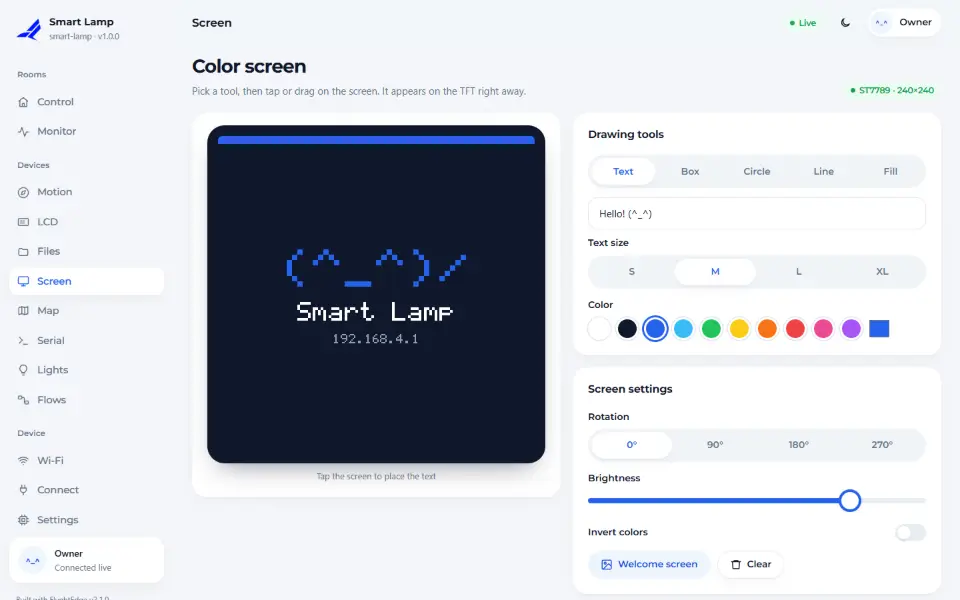
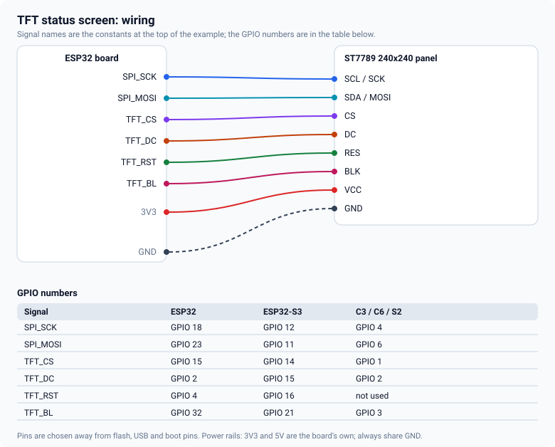

# TFT screen

A small SPI colour screen can show values at the device, and the dashboard mirrors it pixel for pixel,
so you can see on your phone what the panel shows and draw on it. This guide wires a 240×240 ST7789.



## Supported panels

| Panel | Constant | Size |
|---|---|---|
| ST7789 | `fn::TftSpi::ST7789` | 240×240, 240×320, 135×240, 170×320 |
| ILI9341 | `fn::TftSpi::ILI9341` | 240×320 |

The panel driver is separate from the drawing layer, so a panel that is not listed can still be used
through your own graphics library: see the `GfxTarget` adapter in `Tft.h`.

## Wiring



| Panel pin | Connects to |
|---|---|
| SCL / SCK | SPI clock |
| SDA / MOSI | SPI data out |
| CS | chip select |
| DC | data / command |
| RES | reset (optional: `-1` if you tie it to 3.3 V through a resistor) |
| BLK | backlight (optional: `-1` leaves it to the module) |
| VCC, GND | 3.3 V and ground |

The GPIO numbers per chip are in the [pin tables](pin-tables.md).

## The sketch

<!-- example: 12_TftStatus -->
```cpp
fn::Device dev("tft-status");
fn::TftSpi panel(fn::TftSpi::ST7789, 240, 240, TFT_CS, TFT_DC, TFT_RST);
fn::Tft tft(panel);

void setup() {
  Serial.begin(115200);

  panel.pins(SPI_SCK, SPI_MOSI, SPI_MISO);
  tft.backlight(TFT_BL);
```

Drawing is a handful of calls: `clear`, `text`, `rect`, `line`, `circle`, `rotation`, `brightness`.
Colours are RGB565 numbers (`0xFFFF` is white, `0x07E0` green).

<!-- example: 12_TftStatus -->
```cpp
// text() with a background colour overwrites the old value: no flicker from a full clear
tft.text(12, 70, String("Uptime ") + millis() / 1000 + " s    ", WHITE, 2, BLACK);
tft.text(12, 110, String(t, 1) + " C   ", t > 60 ? AMBER : GREEN, 4, BLACK);
```

## Tips

- **Redraw only what changed.** A full `clear()` every second makes the panel flicker. Give `text()`
  a background colour and pad the string, as above.
- **Blank screen.** Check the backlight pin first, then CS and DC. Many modules need `RES` connected.
- **Shifted picture or inverted colours.** Try `tft.rotation(0..3)`; some panels are 240×320 with a
  240×240 window.
- **Sharing the bus with an SD card.** They can share SCK, MOSI and MISO, each with its own CS pin;
  `05_Devices` is wired that way. Keep both CS lines high when you do not use that device.
- **The mirror is a copy of the commands**, not a screenshot of the glass. It is exact for what you
  draw through `Tft`; anything drawn by another library straight to the panel is not mirrored.

<!-- flyght-cloud-footer:start -->
---

**Flyght Cloud.** See this device next to your others, from anywhere: [flyght.obayan.id](https://flyght.obayan.id). Sign in, claim the device with its link, and the dashboard you built here is also on the web.
<!-- flyght-cloud-footer:end -->
