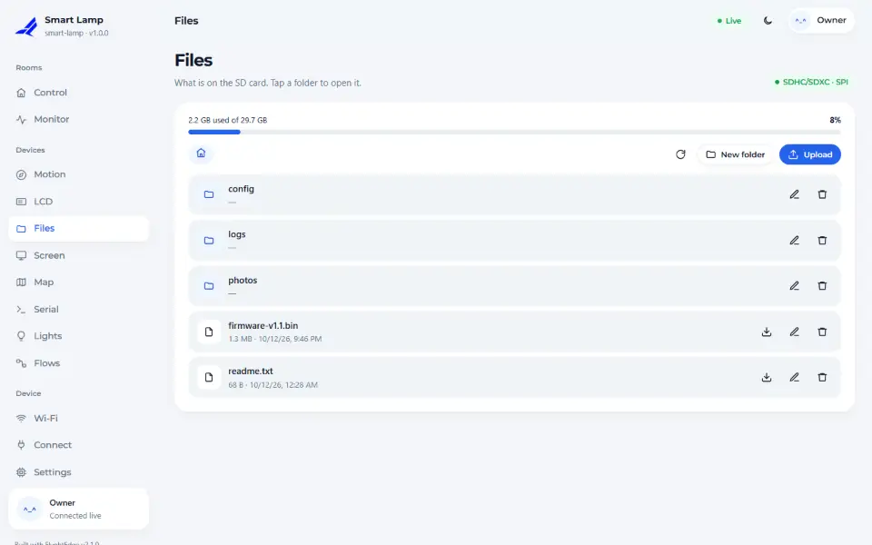
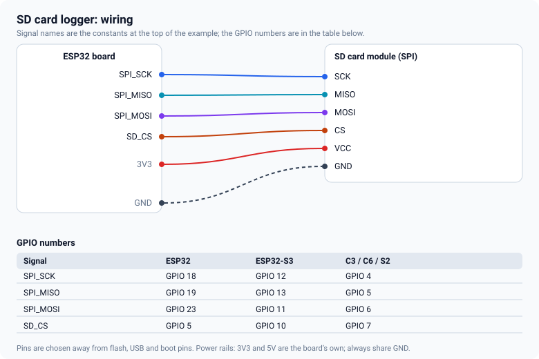

# SD card

An SD card gives the device room for logs, pages and downloads. FlyghtEdge mounts it, shows a file
manager in the dashboard and gives your sketch the standard Arduino `File` API.



## Wiring



Use an SPI card module (the common one with a level shifter works from 3.3 V or 5 V). Share SCK, MISO and
MOSI with other SPI parts, such as a TFT, and give the card its own chip select. Format the card as
**FAT32**. The numbers per chip are in the [pin tables](pin-tables.md).

## The sketch

<!-- example: 13_SdLogger -->
```cpp
fn::Device dev("sd-logger");
fn::SdCard sd(SD_CS);

uint32_t rows = 0;

void setup() {
  Serial.begin(115200);

  sd.pins(SPI_SCK, SPI_MISO, SPI_MOSI);
```

`sd.mounted()` is true once a card was found; it becomes false if the card is removed and true again
when one is back.

Writing uses the normal `File` API. Take the lock while you hold the file, because the dashboard's
file manager uses the same card from another task:

<!-- example: 13_SdLogger -->
```cpp
fn::SdCard::Lock lock(sd);   // the file manager and this sketch share the card
const bool fresh = !sd.fs().exists("/log.csv");
File f = sd.fs().open("/log.csv", FILE_APPEND);
if (!f) return;
if (fresh) f.println("unix_time,uptime_s,chip_c");
```

## The file manager

**Devices → Files** lists the card as folders and files. You can preview text and images, download a
file, upload one, rename it and delete it. Viewers can browse and download;
only admins can upload, create folders, rename, delete and re-mount the card.

## Good practice for a logger

- **Open, write, close.** Do not keep a file open between writes: a power cut then loses less.
- **Log at a sensible rate.** One line every few seconds is plenty; flash cards wear out when written
  continuously at high rates.
- **Put a time in every row.** `fn::unixTime()` is `0` until the clock is set (by Wi-Fi time or by the
  GPS), so a row can say `0` early on; that is information, not an error.
- **Expect the card to disappear.** `appendRow()` returns when `sd.mounted()` is false, so a removed card
  skips rows instead of crashing the sketch.

## Things that go wrong

- **Not mounted.** FAT32 only, 32 GB or less works best. Check CS and that SCK, MISO and MOSI are the
  right way round. Some cards do not like 3.3 V on poor modules; try a different module.
- **Slow dashboard while the card is busy.** Large downloads use the same loop time as everything else;
  prefer smaller files.

<!-- flyght-cloud-footer:start -->
---

**Flyght Cloud.** See this device next to your others, from anywhere: [flyght.obayan.id](https://flyght.obayan.id). Sign in, claim the device with its link, and the dashboard you built here is also on the web.
<!-- flyght-cloud-footer:end -->
