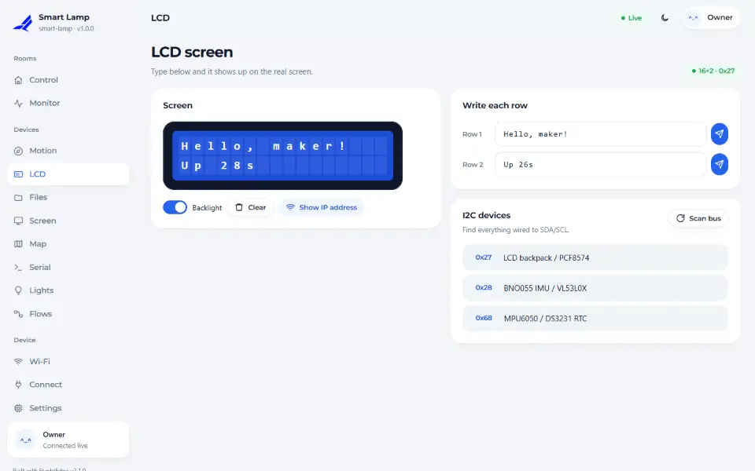
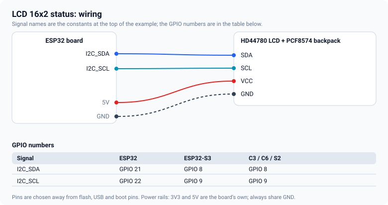
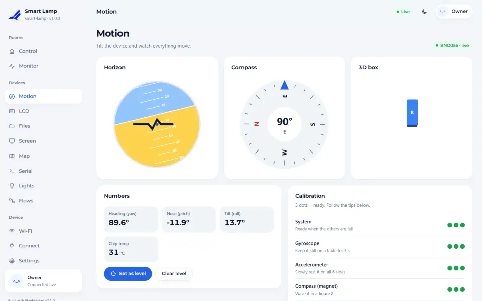
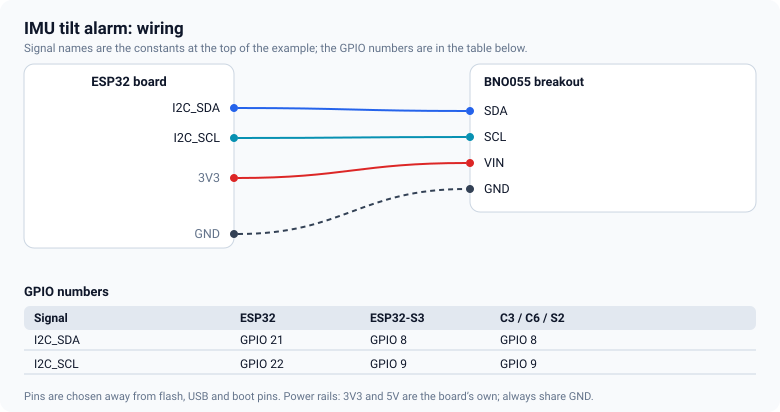

# LCD and IMU

Two small I2C parts that share a bus: a character LCD to show text at the device, and a BNO055 motion
sensor that reports tilt and heading.

## Character LCD



An HD44780 display (16×2 or 20×4) with a PCF8574 backpack uses only two data pins.



<!-- example: 14_LcdStatus -->
```cpp
fn::Device dev("lcd-status");
fn::LcdI2c lcd(16, 2);   // 16 columns, 2 rows

void setup() {
  Serial.begin(115200);

  lcd.pins(I2C_SDA, I2C_SCL);
```

Write a whole row with `lcd.line(row, text)` (it is padded for you), or put text at a position with
`lcd.print(row, col, text)`. `lcd.backlight(on)` switches the backlight. The address (0x27 or 0x3F) is
found automatically.

**Devices → LCD** mirrors the text and has a box to send a message to the display.

- *Blank squares only:* turn the contrast screw on the backpack.
- *Nothing at all:* most backpacks want 5 V for the display; the I2C lines are fine at 3.3 V.
- *Wrong address:* the page has an I2C scanner that lists what answers on the bus.

## BNO055 motion sensor



The BNO055 fuses its own accelerometer, gyroscope and magnetometer, so pitch, roll and heading come
ready to use. The page shows a 3D box, a compass and the calibration status.



<!-- example: 15_ImuTilt -->
```cpp
fn::Device dev("imu-tilt");
fn::Bno055 imu;   // I2C, 0x28

void setup() {
  Serial.begin(115200);

  imu.pins(I2C_SDA, I2C_SCL);
```

`imu.pitch()`, `imu.roll()` and `imu.yaw()` are in degrees, and `imu.ready()` says whether the sensor has
started. `imu.level()` makes the current attitude zero, which is what the **Set level** button does:
mount the sensor, level the machine, press it.

<!-- example: 15_ImuTilt -->
```cpp
const bool tilted = fabsf(imu.pitch()) > TILT_LIMIT || fabsf(imu.roll()) > TILT_LIMIT;
dev.ui().set("alarm", tilted ? "TILTED" : "OK");
```

Give the sensor a minute and a few slow figure-eights to calibrate before you trust the heading. The
calibration is shown in the page and can be saved on the device.

## Sharing the bus

Both parts sit on the same two wires. Give each device its own address (the BNO055 is 0x28 or 0x29, an
LCD backpack 0x27 or 0x3F) and keep the wires short. If the bus does not work, start with one part.

<!-- flyght-cloud-footer:start -->
---

**Flyght Cloud.** See this device next to your others, from anywhere: [flyght.obayan.id](https://flyght.obayan.id). Sign in, claim the device with its link, and the dashboard you built here is also on the web.
<!-- flyght-cloud-footer:end -->
