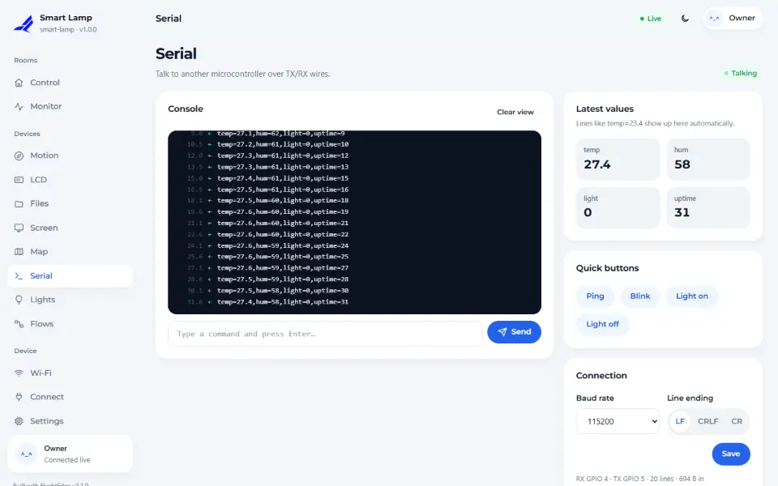
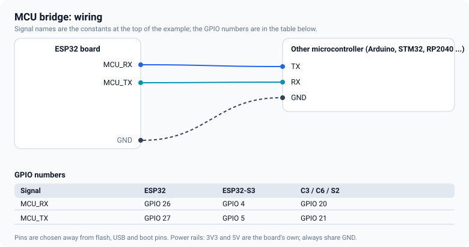

# MCU link

Sometimes the part you need already lives on another board: an Arduino Uno with a sensor shield, an
STM32, a Raspberry Pi Pico. The MCU link connects such a board to the dashboard over a UART with plain
text lines, so you do not have to move its code.



## The protocol

Lines end with a newline and are readable on any terminal.

| Direction | Line | Meaning |
|---|---|---|
| MCU → ESP32 | `temp=23.4` | the value `temp` is 23.4 |
| MCU → ESP32 | `temp=23.4,hum=61` | several values at once |
| MCU → ESP32 | `{"temp":23.4}` | the same, as JSON |
| ESP32 → MCU | `led=1` | the `led` card changed to on |

Every key becomes a live value on the **Serial** page, even keys you did not declare.

## Wiring



Cross the data lines (the MCU's TX to the ESP32's RX) and share ground. **Check the voltage.** An
Arduino Uno talks at 5 V; the ESP32 pins are 3.3 V. Use a voltage divider (a 1 kΩ and a 2 kΩ resistor)
or a level shifter on the Uno's TX line.

## The sketch

<!-- example: 16_McuBridge -->
```cpp
fn::Device dev("mcu-bridge");
fn::McuLink mcu(MCU_RX, MCU_TX, 115200, Serial1);

void setup() {
  Serial.begin(115200);
```

<!-- example: 16_McuBridge -->
```cpp
mcu.bind("temp", "temp")        // "temp=.." fills the "temp" card
    .bind("hum", "hum")
    .forward("led")             // the "led" card sends "led=1" / "led=0"
    .quick("Ping", "PING");     // a button in the console
dev.use(mcu);
```

- `bind(key, widgetId)` copies an incoming value into a card.
- `forward(widgetId)` sends the card's changes to the MCU as `id=value`.
- `quick(label, command)` adds a one-tap button in the console that sends a fixed line.
- `onLine(callback)` gives you every line, for protocols of your own.

The header of `16_McuBridge` contains a minimal sketch for the Arduino side.

## Tips

- **Baud rate** must match on both sides; 115200 is a good default. A lower rate is steadier over long
  wires.
- `mcu.online()` is true while data arrived in the last five seconds, which is a simple link check.
- The ESP32 pins you choose must not be the ones used for the USB console (UART0 on most boards).

<!-- flyght-cloud-footer:start -->
---

**Flyght Cloud.** See this device next to your others, from anywhere: [flyght.obayan.id](https://flyght.obayan.id). Sign in, claim the device with its link, and the dashboard you built here is also on the web.
<!-- flyght-cloud-footer:end -->
