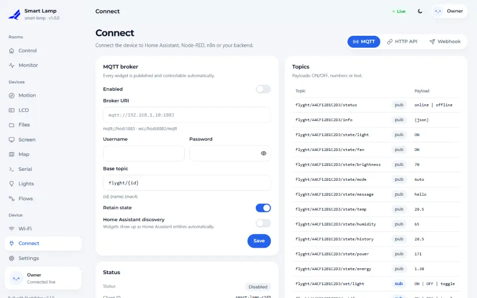

# MQTT and Home Assistant

Every card on the dashboard is also an MQTT topic. Point the device at a broker and Home Assistant,
Node-RED or any MQTT client can read and command it. With Home Assistant's MQTT discovery switched on,
the cards appear there by themselves.



## Topics

With the default base topic `flyght/<id>` (`<id>` is the device's 12-character id):

| Topic | Direction | Payload |
|---|---|---|
| `<base>/status` | device → broker | `online` / `offline` (retained; `offline` is the last will) |
| `<base>/state/<widget>` | device → broker | `ON` / `OFF`, a number or text |
| `<base>/set/<widget>` | broker → device | the same, plus `toggle` for a toggle and `PRESS` for a button |

Changes made on the dashboard, over HTTP or from a flow are published to `state/...`, so the broker
always shows the real state, not only what MQTT asked for.

## Setting the broker

In code, as a default for the first boot:

<!-- example: 18_HomeAssistant -->
```cpp
dev.mqtt().broker(BROKER).credentials(MQTT_USER, MQTT_PASS).baseTopic("flyght/{id}").homeAssistant(true);
```

Or on the dashboard under **Connect → MQTT**, which also has a *Test* button. What you save there wins
over the sketch. Use `mqtts://` for a broker with TLS.

## Home Assistant

With `homeAssistant(true)` the device publishes a discovery message for each widget:

| Widget | Home Assistant entity |
|---|---|
| Toggle | `switch` |
| Button | `button` |
| Slider | `number` |
| Select | `select` |
| Gauge, value, chart | `sensor` |
| Text | `text` |

Nothing goes into Home Assistant's YAML. If you rename a card, remove the old entity in Home Assistant
and let the device announce the new one.

## Your own topics

The module is open for your own messages, next to the automatic ones:

<!-- example: 18_HomeAssistant -->
```cpp
if (dev.mqtt().connected()) dev.mqtt().publish(dev.mqtt().base() + "/heartbeat", String(millis() / 1000));
```

You can subscribe with `dev.mqtt().subscribe(topic, callback)`; the callback runs on the main loop.

## Notes

- The local MQTT module and [Flyght Cloud](12-flyght-cloud.md) are independent. You can use either, both
  or neither, and your own broker keeps working when the cloud is not reachable.
- Retained state messages mean a restarted Home Assistant sees current values straight away.
- Use a broker user for the device, not your own account, and give it only the topics under its base.

<!-- flyght-cloud-footer:start -->
---

**Flyght Cloud.** See this device next to your others, from anywhere: [flyght.obayan.id](https://flyght.obayan.id). Sign in, claim the device with its link, and the dashboard you built here is also on the web.
<!-- flyght-cloud-footer:end -->
