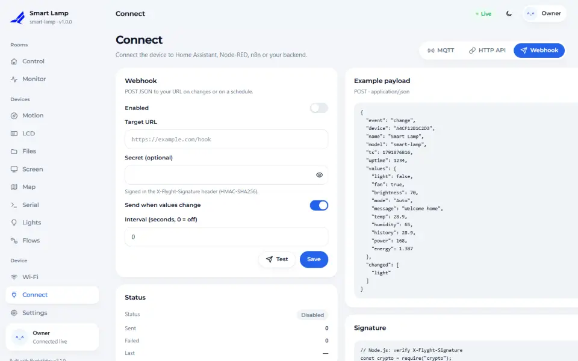
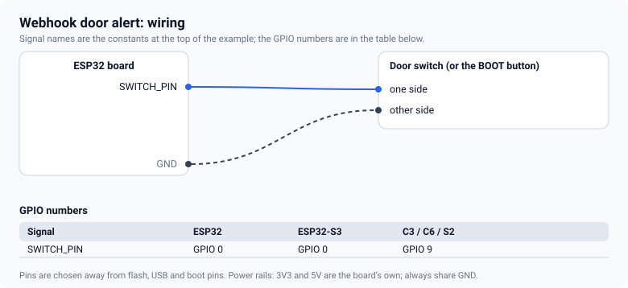
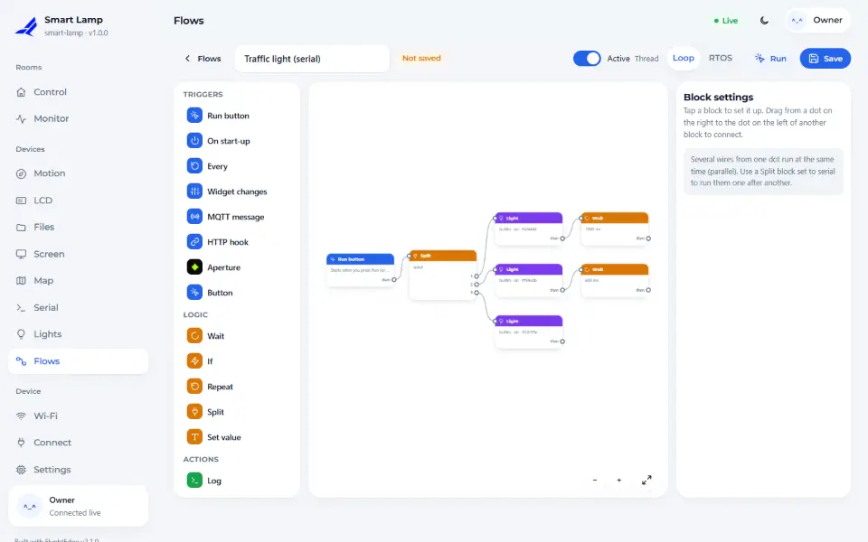
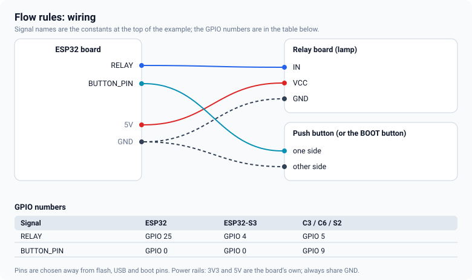

# Webhooks and flows

Two ways to react to what happens: a **webhook** tells another system, a **flow** acts on the device
itself. Both are driven by the same events, the changes of your cards, and neither needs more code than
a line or two.

## Webhooks

A webhook is an HTTPS `POST` with a JSON body, sent when a card changes, at an interval, or when your
sketch sends an event of its own.



<!-- example: 19_WebhookAlerts -->
```cpp
dev.webhook().url(URL).secret(SECRET).interval(0);   // interval 0: only on changes and events
```

An event from the sketch carries whatever you add:

<!-- example: 19_WebhookAlerts -->
```cpp
fn::Json extra;
extra.set("count", (unsigned long)count);
extra.set("uptime", (unsigned long)(millis() / 1000));
dev.webhook().send("door", extra);
```

Wiring for the example is a switch between a pin and ground (the BOOT button works for a test):



### Verify the signature

Every request carries `X-Flyght-Signature`: the HMAC-SHA256 of the raw body, in hex, with your secret.
Check it before you trust a request. In Node.js:

```js
import crypto from 'node:crypto';

function verify(rawBody, header, secret) {
  const expected = crypto.createHmac('sha256', secret).update(rawBody).digest('hex');
  const a = Buffer.from(expected), b = Buffer.from(String(header));
  return a.length === b.length && crypto.timingSafeEqual(a, b);
}
```

Use the *raw* bytes of the body, not a parsed and re-serialised object, and use `https://` for the
target so the secret and the data stay private. The **Test** button sends a sample request.

## Flows

A flow is a small automation you draw in the browser: a trigger, some logic and an action, connected
with wires. It runs on the device, so it keeps working when the network is down, and it is saved there.



`20_FlowsRules` declares only the parts; the rules are made on the dashboard under
**Devices → Flows**:

<!-- example: 20_FlowsRules -->
```cpp
dev.features().defaultOn("flows");   // on at the first boot; Settings > Plan & features can change it

lamp.channel(RELAY, "Lamp").maxOn(3600);
button.activeLow().labels("PRESSED", "released").debounce(40);
```



To make the lamp follow the button: add a trigger that fires when the `Button` card changes, add a
*Set widget* action for `Lamp`, wire one to the other, switch the flow on and press **Run** to test it.

What a flow can do:

- **Triggers:** a card changes, a timer (*Every*), the *Run* button, device start-up, a push button on
  a GPIO pin, an incoming HTTP hook, an MQTT message, an Aperture vision event.
- **Logic:** *If*, *Wait*, *Repeat*, *Split* (in parallel or one after another) and *Set value*.
- **Actions:** set a card, set a light or run a light effect, make an HTTP request, publish an MQTT
  message, write a GPIO pin, write to the log.

### Safety rules built in

- Blocks cannot drive pins that a module owns (an LED, a bus, a relay board), the SPI flash or USB.
- Timers are 50 ms or slower, and a flow has at most 40 blocks; at most 8 flows exist.
- Flows are a Pro feature. Without a license key the 30-minute evaluation allows them.

<!-- flyght-cloud-footer:start -->
---

**Flyght Cloud.** See this device next to your others, from anywhere: [flyght.obayan.id](https://flyght.obayan.id). Sign in, claim the device with its link, and the dashboard you built here is also on the web.
<!-- flyght-cloud-footer:end -->
