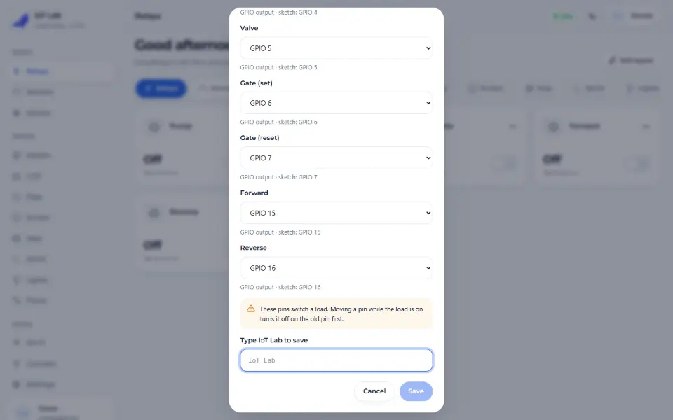
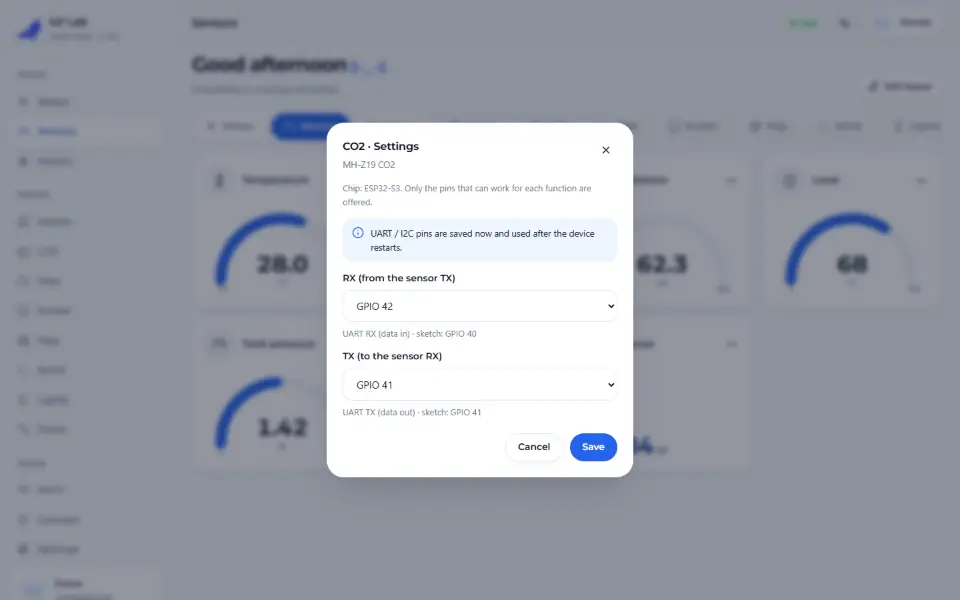
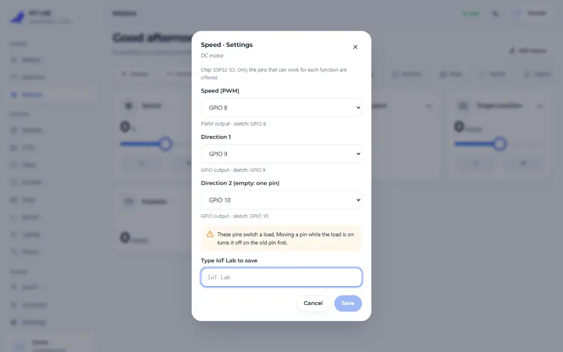
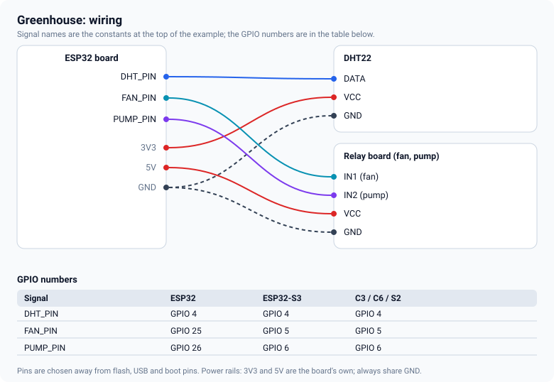
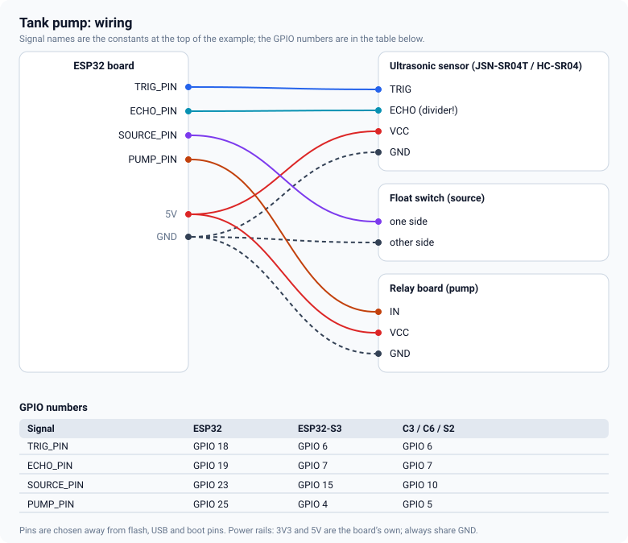
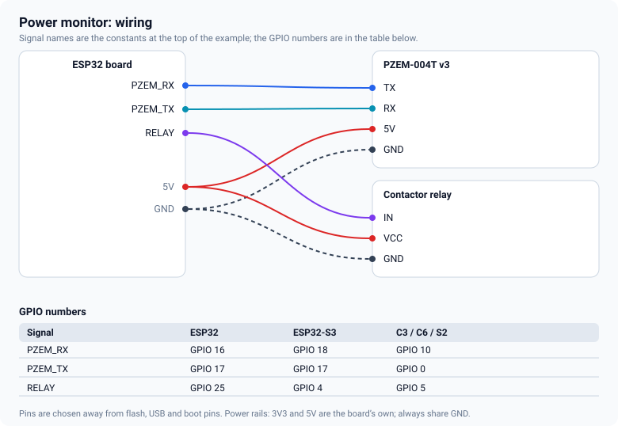

# Relays, sensors and motors

The parts most IoT projects are made of. Each is a module that you create, add with `dev.use(...)` and
that then appears on the dashboard as one or more cards. Only the modules your sketch creates are
linked into the firmware.

> **Not a safety function.** Interlocks, maximum on-times and Stop buttons are conveniences that make
> a project behave. An emergency stop belongs in hardware: a contactor, a safety relay, a fuse. And mains
> voltage is lethal; wire it only if you are qualified to.

## Relays

`fn::Relay` drives 1 to 16 channels on GPIO pins. Each channel is a toggle card.

| Option | Meaning |
|---|---|
| `channel(pin, name, type)` | a channel; `Type::ActiveHigh` (default) or `ActiveLow` for low-level-trigger boards |
| `latching(setPin, resetPin, name)` | a bistable relay: a short pulse on one pin sets it, on the other resets it |
| `bootOn()` | the channel is on after a start (default off) |
| `maxOn(seconds)` | it switches itself off after this long |
| `pulse(ms)` | every "on" lasts this long, then off |
| `interlock(group)` | channels of one group are never on together (forward and reverse, for example) |
| `minOff(seconds)` | a rest time before it may be switched on again (valves, compressors) |

<!-- example: 07_Relays -->
```cpp
relays.channel(PUMP, "Pump").maxOn(600);
relays.channel(VALVE, "Valve", fn::Relay::Type::ActiveLow);
relays.latching(GATE_SET, GATE_RESET, "Gate");
relays.channel(FWD, "Forward").interlock(1);
relays.channel(REV, "Reverse").interlock(1);
```

Pins are written to their off level *before* they become outputs, so a relay board does not click when
the firmware starts. `fn::Solenoid` is a one-channel relay with a maximum on-time and a rest time.

## Sensors

| Class | Reads | Pins |
|---|---|---|
| `Dht` | DHT11 / DHT22 temperature and humidity | one data pin |
| `Ds18b20` | DS18B20 temperature | one 1-Wire pin with a 4.7 kΩ pull-up to 3.3 V |
| `Ultrasonic` | distance, and tank level in % | trigger and echo |
| `AnalogSensor` | anything with an analog output: water level, O2, H2, MQ gas, ACS712 current | one ADC1 pin |
| `DigitalSensor` | a float switch, a water-leak probe, a flame sensor, a door | one input |
| `Mhz19` | CO2 | UART |
| `Pzem` | mains voltage, current, power, energy | UART |
| `Ina219` | DC voltage, current, power | I2C |

Every reading is a card. A reading that cannot be trusted shows **—**, never a number that merely
looks plausible, and a sensor with no valid reading for five intervals turns its module *degraded* in
the health list. A sensor can also raise an alarm with hysteresis, and call you back when it changes:

<!-- example: 22_Greenhouse -->
```cpp
// alarm on the first reading (temperature): on at 30 C, off at 27 C; the callback runs the fan
dht.every(5000).alarm(30, 27, [](bool hot) { outputs.set(0, hot); });
```

Calibration is yours. A gas sensor shows what its curve says; compare it with a reference before you
rely on it.

## Motors

| Class | Drives | Notes |
|---|---|---|
| `DcMotor` | a brushed motor on an H-bridge (L298N, TB6612, L9110) | speed −100…100 %, a reversal goes through zero, ramp, maximum run time |
| `Esc` | a brushless motor through an ESC | arms on an idle pulse first, then throttle 0…100 % |
| `Stepper` | a step/direction driver (A4988, DRV8825, TB6600) | move to a position with acceleration, travel limits |

Every motor starts stopped, has a **Stop** card and a `stop()` call, and stops by itself after its
maximum run time. **Take the propeller off** while you test an ESC.

## Moving a pin from the dashboard

Wiring changes. You do not have to recompile when it does. On any card of these modules an admin sees a
**⋯** menu with **Settings**:



<p>
  
  
</p>

- The list names what each pin does: GPIO output, analog (ADC1), UART RX/TX, I2C SDA/SCL, step, direction.
- **Only pins that can work are offered.** Flash and USB pins never are. An output never gets an
  input-only pin, an analog input only gets an ADC1 pin, and a pin that another device uses is shown as
  taken.
- Boot pins (strapping pins) are allowed but marked, because a wrong level at reset changes how the
  chip starts.
- A device that **switches a load** asks you to type the device name before it saves.
- GPIO pins apply at once: the load is switched off first, and the old pin is left low, not floating.
  UART and I2C pins are saved and used after the next restart.
- A saved pin wins over the one in the sketch.

The same rules are enforced by the firmware's HTTP API, so a script cannot save a pin the dialog would
have refused.

## Three complete projects

### Greenhouse (`22_Greenhouse`)

A DHT22, a fan and a pump. When the temperature reaches 30 °C the alarm turns on and the fan runs; it
stops at 27 °C. The pump also switches itself off after five minutes.



### Tank pump (`23_TankPump`)

An ultrasonic sensor above a tank turns distance into a level; the pump starts below 25 % and stops
above 85 %. A float switch in the source keeps the pump off when there is no water to pump. If the
pump hits its 20-minute limit without reaching the level, Auto is switched off and the card says so: a
leak or an empty source is something to look at, not something to retry forever.



### Power monitor (`24_PowerMonitor`)

A PZEM-004T measures an AC load. An over-voltage alarm turns on at 250 V, and if the current stays above
the limit the contactor relay opens the load.



> Mains wiring needs a certified enclosure, a proper breaker and a qualified electrician. The cut-off
> in the sketch is monitoring and a convenience, not a protection device.

## Limits

- One ultrasonic sensor per firmware, and one DS18B20 per pin.
- A new stepper target waits for the move in progress; the stepper runs up to a few thousand steps a
  second.
- A DHT read holds interrupts for about 5 ms, once per interval.
- These modules were compiled and tested against their logic on a computer. Check each one on your
  hardware, with the load disconnected first.

<!-- flyght-cloud-footer:start -->
---

**Flyght Cloud.** See this device next to your others, from anywhere: [flyght.obayan.id](https://flyght.obayan.id). Sign in, claim the device with its link, and the dashboard you built here is also on the web.
<!-- flyght-cloud-footer:end -->
