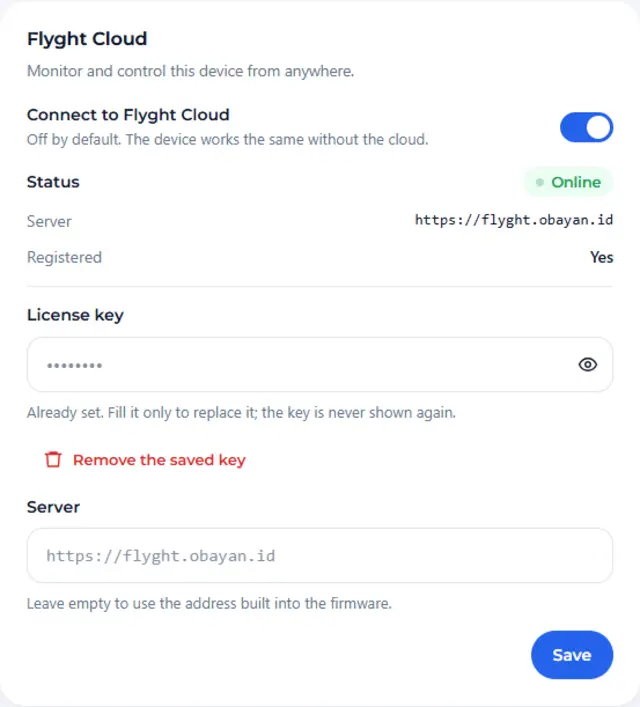
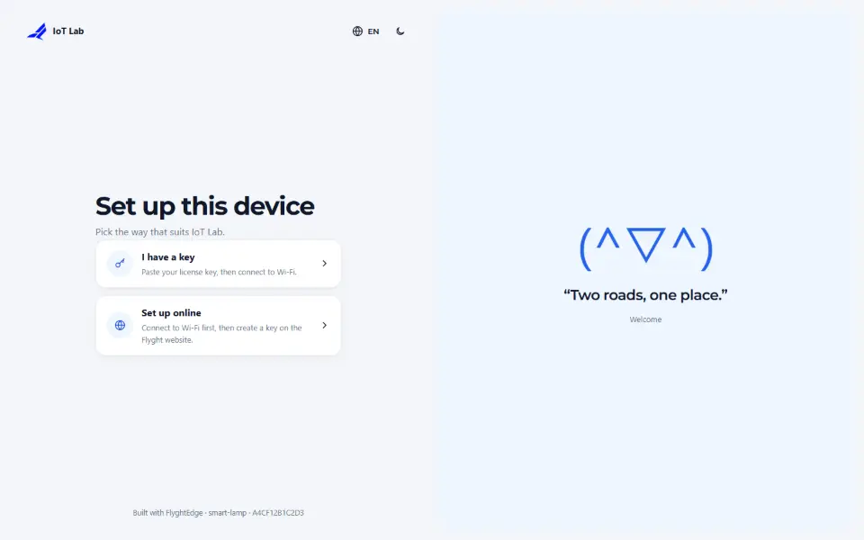
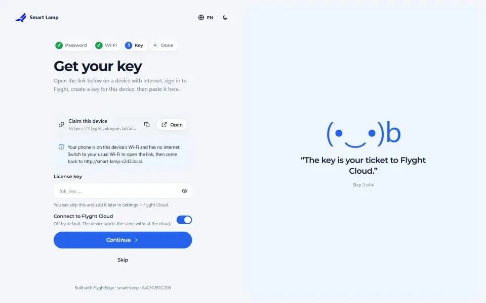

# Flyght Cloud

**Flyght Cloud** is the official web dashboard for FlyghtEdge devices, at
**[flyght.obayan.id](https://flyght.obayan.id)**. It lists your devices in one place, shows their state
and lets you control them from anywhere, not only when you are on the same Wi-Fi.

It is optional. A device works the same without it, and the local dashboard, MQTT and webhooks are not
affected either way.

## What you get

- Your devices together, in one account, with their cards.
- Control and live state from outside your home network.
- A key and device list you can manage on the site.

## How a device connects

1. **Get a key** on the site. The key is the same license key you put in the sketch with
   `dev.license(...)`.
2. **Switch the cloud on**, either in the sketch or in **Settings → Flyght Cloud**:

   <!-- example: 21_CloudClaim -->
   ```cpp
   dev.cloud().enable();            // off by default; also a switch in Settings > Flyght Cloud
   dev.license(FN_LICENSE_KEY);
   ```

3. **The device registers itself** with its key, over HTTPS, and is told where to connect.
4. **Claim it in your account.** The device shows a link in the setup wizard and in
   **Settings → Flyght Cloud** (the cloud example also prints it to the Serial Monitor). Open it while
   you are signed in.



## During setup

The first screen of the setup wizard offers the two ways that fit the two situations:

<p>
  
  
</p>

- **I have a key:** paste it, then connect to Wi-Fi.
- **Set up online:** connect to Wi-Fi first, then open the link, create a key on the site and paste it.
  Your phone is on the device's own network, which has no internet, so open the link on a network
  that does and then come back to the device's address.

The key typed here is the Flyght Cloud key. The edition of the firmware (which features are unlocked)
still comes from `dev.license()` in the sketch.

## Status

| Status | Meaning |
|---|---|
| Off | not switched on |
| No network | waiting for Wi-Fi |
| Needs a license key | no key, or the server does not accept it |
| Claiming, Fetching settings, Connecting | on its way |
| Online | connected |
| Retrying | the server is busy or unreachable; it tries again with a growing pause |
| Stopped | the server refused this device (key revoked, device blocked, owned by another account, no free slot); the card says which |

## Server address and privacy

The firmware carries one address, `https://flyght.obayan.id`. It is not a setting on the device: the
dashboard shows it but does not change it, and the local API refuses a `site` sent to
`PUT /fn/api/v1/cloud` (403). A build of your own points somewhere else with
`dev.cloud().site("https://your.server")` or `-DFN_CLOUD_SITE=...`. Everything else, the broker
included, comes from the server, so a device follows the server if it moves.

The device sends its widget states and who it is: device id, name, model, firmware and library version,
and where it can be reached on your network (its local IP and `.local` address). The license key is used
to register and is stored on the device only; the dashboard and the API tell you whether a key is set,
never what it is. You can remove a saved key from the card; it asks for the
device name first.

## Troubleshooting

- *Needs a license key:* the key is missing from the sketch and from **Settings**. Paste it there, or
  add `dev.license(...)`.
- *Retrying for a long time:* the device cannot reach the site. Check its Wi-Fi and the clock; TLS needs
  the right time, which the device gets from the network.
- *Stopped:* read the message on the card; it tells you whether the key, the device or the account is
  the reason.

See also [MQTT and Home Assistant](09-mqtt-and-home-assistant.md) for a broker of your own, which
works at the same time.

<!-- flyght-cloud-footer:start -->
---

**Flyght Cloud.** See this device next to your others, from anywhere: [flyght.obayan.id](https://flyght.obayan.id). Sign in, claim the device with its link, and the dashboard you built here is also on the web.
<!-- flyght-cloud-footer:end -->
