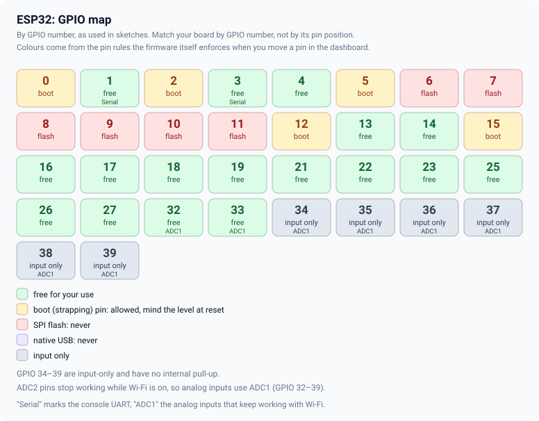
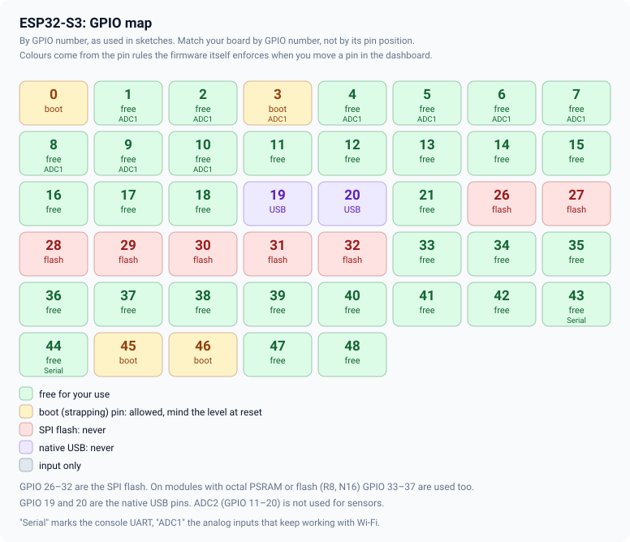
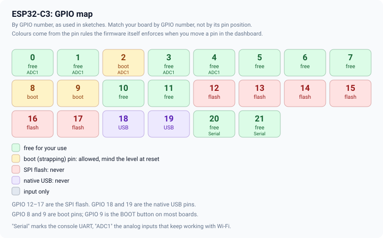
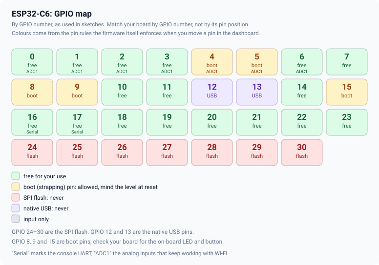

# Wiring and pinout

Almost every problem with a new project is a wiring problem. This guide has the rules that keep you out
of trouble, the GPIO map of each chip, and a wiring diagram for every example.

## Pin numbers: use GPIO numbers

Sketches use **GPIO numbers**, the number in `GPIO18`. The labels printed on a board (`D5`, `IO18`,
a pin position) differ from board to board. Find the GPIO number in your board's own pinout and use
that number in the sketch. Every number in these guides is a GPIO number.

## Rules that save an evening

1. **3.3 V logic.** ESP32 pins are 3.3 V and are not 5 V tolerant. A 5 V signal such as an HC-SR04
   echo or an Arduino Uno's TX needs a divider (1 kΩ and 2 kΩ) or a level shifter.
2. **Common ground.** Every board and module must share a ground. A missing ground produces
   "random" behaviour.
3. **Power the loads separately.** Relay boards, motors, servos and pumps need their own supply, not the
   board's 3.3 V pin. Connect only the grounds.
4. **Flyback diodes.** A relay coil, a solenoid or a motor you drive yourself needs a diode across it.
   Ready-made relay boards have them.
5. **Pull-ups.** I2C lines (SDA, SCL) and 1-Wire need pull-up resistors. Most breakout boards have them;
   if two boards each have one, that is fine.
6. **Keep wires short** for I2C and SPI, and away from motor and mains wiring.
7. **Do not use the pins in red on the charts below.** The firmware refuses them in the dashboard too.

## GPIO maps

Each chart is drawn from the same pin rules the firmware enforces when you move a pin in the dashboard.
Green pins are free to use; amber ones are boot pins (allowed, mind the level at reset); red pins
are the SPI flash and purple pins are the native USB port.

> The ESP32-S2 and ESP32-C5 follow the same rules in the firmware, but there is no chart for them
> yet. Pins that exist on a chip but are wired to PSRAM or flash on your module are not shown by the
> chart; the datasheet of the module says which they are.

## Wiring diagrams of the examples

The numbers in each diagram come from the pin block at the top of the sketch, so they are always the
ones the code uses. The [pin tables](pin-tables.md) list them all by chip.

| Example | Diagram |
|---|---|
| `10_GpsTracker` | [GPS module](../images/diagrams/wiring-10_GpsTracker.svg) |
| `11_GpsGeofence` | [GPS + siren relay](../images/diagrams/wiring-11_GpsGeofence.svg) |
| `12_TftStatus` | [ST7789 panel](../images/diagrams/wiring-12_TftStatus.svg) |
| `13_SdLogger` | [SD card module](../images/diagrams/wiring-13_SdLogger.svg) |
| `14_LcdStatus` | [LCD 16×2 over I2C](../images/diagrams/wiring-14_LcdStatus.svg) |
| `15_ImuTilt` | [BNO055](../images/diagrams/wiring-15_ImuTilt.svg) |
| `16_McuBridge` | [another microcontroller](../images/diagrams/wiring-16_McuBridge.svg) |
| `19_WebhookAlerts` | [door switch](../images/diagrams/wiring-19_WebhookAlerts.svg) |
| `20_FlowsRules` | [relay and button](../images/diagrams/wiring-20_FlowsRules.svg) |
| `22_Greenhouse` | [DHT22, fan and pump](../images/diagrams/wiring-22_Greenhouse.svg) |
| `23_TankPump` | [ultrasonic, float switch, pump](../images/diagrams/wiring-23_TankPump.svg) |
| `24_PowerMonitor` | [PZEM-004T and contactor](../images/diagrams/wiring-24_PowerMonitor.svg) |

## Several parts on one board

- **SPI** (TFT, SD card) shares SCK, MOSI and MISO; each part has its own CS.
- **I2C** (LCD, IMU, INA219) shares SDA and SCL; each part has its own address.
- **UART** (GPS, MH-Z19, PZEM, MCU link) needs its own pair of pins and its own serial port. The
  original ESP32 and the S3 have three UARTs; the C3, C6 and S2 have two, and one of them is the
  console. `FN_SPARE_UART` is the spare one on every chip.

<!-- flyght-cloud-footer:start -->
---

**Flyght Cloud.** See this device next to your others, from anywhere: [flyght.obayan.id](https://flyght.obayan.id). Sign in, claim the device with its link, and the dashboard you built here is also on the web.
<!-- flyght-cloud-footer:end -->
